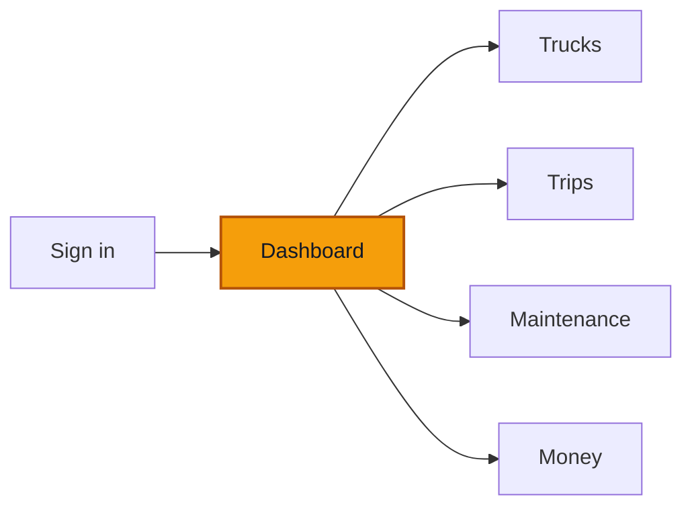

# Dashboard

**Goal** — Read the Dashboard: are we making money, what changed, and what needs you. Check that every number matches the lists behind it.

**Log in as** — the Director (`emilienne`). Then Finance (`nadege`), the Administrator for Yaoundé (`amadou`), the Cashier (`clarisse`) and the Technician (`herve`) for the role checks. PINs are on [Access](/start-here/01-access).

## Where you are

## Who sees what

| Role | Dashboard |
| --- | --- |
| Director, Administrator, Finance | The full Dashboard below, with profit |
| Administrator of a branch with no revenue | The costs view: **Expenses**, **Truck costs**, **Company costs**, no profit |
| Cashier, Driver | A short Dashboard: **Trucks in service** and **Recent entries** |
| Technician | No Dashboard: lands on the Maintenance Overview |

## Steps

1. Sign in as `emilienne` and switch to English.

> ✅ Expected: the page is titled **Dashboard**, with the line *Are we making money, what changed, and what needs you?* Four tabs: **Overview**, **To do** (with a count), **Profit by truck** and **Profit by branch**.

2. Look at the range buttons under the tabs.

> ✅ Expected: **This month**, **3 months** and **12 months**. On the right, the comparison, for example *1–11 October compared with 1–11 September*: this month so far is compared with the same days of last month.

### The summary

3. Read the card under the range.

> ✅ Expected: a small heading such as **Something changed · Sunday 11 October** (or *Monday summary*, *Start of the month summary*), one bold sentence about the result, a badge on the right (for example **Not enough data yet** or **First month**), and a second sentence about what changed (for example *VH003 was grounded on 8 October and is still off the road.*). Under a thin line, a small "what was counted" line starts *Profit = revenue − expenses recorded in ROUTIQ; taxes and loan repayments aren't in it. Counted: …*

4. Click the cross at the top right of the summary.

> ✅ Expected: the summary closes. The "Counted: …" line stays, now just under the tiles, followed by **Show summary**. The summary stays closed when you leave the page and come back.

5. Click **Show summary**.

> ✅ Expected: the summary comes back in its place.

When the summary shows is a company setting: **Every Monday and on the 1st of the month** by default. It also shows when something big changes. See [Company settings](/company/company-settings).

### The tiles

6. Read the five tiles.

> ✅ Expected:
> - **Revenue**, **Expenses** and **Profit**, each in FCFA with the change against the comparison period under it (for example *▲ 85 000 FCFA vs 1–11 Sept*). On **12 months**, Profit also shows its share of revenue, for example *47% of revenue*.
> - **Cost per km**: an amount per km, or **Not recorded** when km or fuel are missing, with *Km known for 3 of 3 trucks* under it.
> - **Trucks that can drive**: for example **1 of 3**, with *2 cannot drive today*. This is the same count as **Can drive** on the Trucks Overview.

7. Click **12 months**.

> ✅ Expected: the tiles, the chart and the tables all change to *October 2025 – September 2026*, the last 12 closed months. The address now ends with `?range=12-months`, so a reload keeps the range.

### What changed the profit

8. Read **What changed the profit**.

> ✅ Expected: a bridge chart from the comparison period's profit (left, black) to this period's profit (right, black). Between them, one bar per reason: **Revenue**, each expense category (**Fuel**, **Driver allowance**, **Repairs**, **Tolls**) and **Company costs**. *Blue raised the profit, orange lowered it.* The bars add up exactly from the first total to the last. **Table** shows the same numbers as a table.

### To do

9. Read the **To do** card, then click **See all 7** (the count may differ).

> ✅ Expected: *Ranked by safety, then money · all your branches*. Safety comes first (a truck off the road, an expired **Visite technique**, a problem nobody has planned), then money (expenses waiting for your approval, entries with no receipt, a month still open). Each row has one button: **Open**, **Plan the repair**, **Review**, **Open entries** or **Close month**. **See all** opens the **To do** tab with every row.

10. Click **Review** on *expenses wait for your approval*.

> ✅ Expected: **Money → To approve** opens with those entries.

### Profit by truck and by branch

11. Back on Overview, read **Profit by truck**.

> ✅ Expected: one row per truck with **Branch**, **Trips**, **Km**, **Revenue**, **Expenses** and **Profit**, losses first. A truck that lost money reads **Loss 171 000 FCFA**, never a minus profit. Under the table: **Profit of all trucks (3)**, **Company costs** and **Company profit**. Company profit = profit of all trucks − company costs.

12. Click the **Profit by truck** tab, then **Profit by branch**.

> ✅ Expected: the same table on its own page, with rows per page and paging; then **Truck profit by branch** with **Trucks**, **Revenue**, **Expenses** and **Truck profit** per branch, and the note *Company costs (0 FCFA) are not split by branch.* The range you picked stays the same on every tab.

13. Scroll to the bottom of Overview.

> ✅ Expected: **Revenue and expenses per month** (a line chart of the last 12 closed months, with **Open Money** and **Table**), **Truck profit by branch** (with **Open the tab**), and **Coming up** (*Next 14 days · all your branches*, for example a truck's insurance renewal date).

### On a phone

14. Open the Dashboard at phone width.

> ✅ Expected: tiles two per row; **To do** right after the tiles; **What changed the profit** as a list (one line per reason, the two totals in bold); **Trucks at a loss** instead of the full truck table (only when a truck lost money in the range).

### Role checks

15. Sign in as `amadou` (Administrator, Yaoundé only).

> ✅ Expected: the header shows **Yaoundé**. Yaoundé has no trucks and no revenue, so the Dashboard shows the costs view: tiles **Expenses**, **Truck costs**, **Company costs**, **Cost per km** and **Trucks that can drive** (*0 of 0*, *No truck is in the fleet yet*), **What changed the expenses** and **Cost by truck**. No profit anywhere.

16. Sign in as `clarisse` (Cashier), then `herve` (Technician).

> ✅ Expected: Clarisse sees **Trucks in service** and **Recent entries**, no revenue, expenses or profit tiles. Hervé lands on **Maintenance**, and the **Dashboard** row takes him there too.

## Try to break it

- **Numbers that disagree.** Click each tile. The list it opens must show the same count or sum. **Trucks that can drive** must match **Can drive** on the Trucks Overview.
- **Range lost.** Pick **3 months**, open **Profit by branch**, reload. Expect **3 months** still picked.
- **Branch picked.** Pick **Douala** in the header. Every tile, chart and table should narrow to Douala.
- **A minus profit.** Look for a negative profit with a minus sign anywhere. Losses must read **Loss … FCFA**.
- **Bridge that doesn't add up.** Add the bridge bars by hand. They must take you exactly from the first total to the last.
- **Summary that won't stay closed.** Close the summary, open Money, come back. Expect it still closed.

## Report it

Use the template in [Reporting bugs](/testing/reporting-bugs).

Next: [Trucks — Overview and list](/daily-work/trucks/01-overview-and-list)
