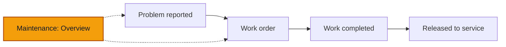

# Maintenance — Overview

**Goal** — Read the Maintenance page: which problems are open, which trucks are off the road, which work orders are running and what repairs cost. Check that each tile opens the list it counts.

**Log in as** — the Technician (`herve`). The Director (`emilienne`) and the Administrator (`boris`) see the same page. Finance, the Cashier and the Driver have no **Maintenance** row in the sidebar. PINs are on [Access](/start-here/01-access).

## Where you are

## Words used on this page

- A **problem** is something wrong with a truck, reported by anyone who drives or repairs it. It gets a number such as **PRB-0002**.
- A **work order** plans the repair and its expected cost. It gets a number such as **WO-0001**.
- A **safety-critical** problem **grounds** the truck the moment it is reported. A grounded truck cannot drive until someone releases it to service. Completing the work does not lift the grounding.
- **Off the road** counts trucks that are grounded.

The numbers below come from the demo seed, before anyone has changed it. Dates move with the day the workspace was seeded.

## Steps

### The Overview

1. Sign in as `herve`.

> ✅ Expected: Hervé lands on **Maintenance**, not on a Dashboard. The sidebar shows **Dashboard**, **Trucks** and **Maintenance**; the **Dashboard** row also opens Maintenance. **Maintenance** carries a red count: the problems that have no work order yet (**1**).

2. Read the top of the page.

> ✅ Expected: the title **Maintenance** with *Problems reported and work orders, from report to repair.* Two buttons: **Report a problem** and **Create work order**. Three tabs: **Overview**, **Problems** (with a count of open problems, **2**) and **Work orders**.

3. Read the summary card.

> ✅ Expected: a small heading such as **Something changed · Sunday 11 October**, the bold sentence *2 problems are open, 1 of them safety-critical.*, a badge **1 off the road**, then *1 truck is off the road. VH003 was grounded on 8 October and is still off the road.* Under a thin line: *Repair time and cost over the last 90 days, from 1 completed work order.* The cross closes the card.

4. Read the five tiles.

> ✅ Expected:
> - **New problems**: **2**, *1 safety critical*.
> - **Off the road**: **1**, *VH003 · since 8 October 2026*.
> - **Work orders open**: **1**, *0 waiting approval · 0 waiting sign-off*.
> - **Average days to repair**: a number of days, *1 repair in the last 90 days*.
> - **Repair cost**: **85 000 FCFA**, *1 work order completed in the last 90 days*.

5. Read the two cards under the tiles.

> ✅ Expected:
> - **Days off the road per month**: *Are repairs keeping trucks off the road longer? Truck-days in the workshop or grounded.* One bar per month for the last 12 months, the current month marked partial (*October is partial (11 days).*). **Table** shows the same numbers as a table. **Open Work orders** opens the **Work orders** tab.
> - **To do**: *Safety first*. One row per problem nobody has planned yet, for example *VH003 · Rear mudguard cracked and loose on its bracket, Reported 17 hours ago*, with **Triage**.

6. Click **Triage**.

> ✅ Expected: VH003 opens on its **Maintenance** tab with the problem's panel open. From there you plan the repair: see [Work orders](/daily-work/maintenance/03-work-orders).

### Tiles open their lists

7. Go back to **Maintenance** and click each tile in turn.

> ✅ Expected:
> - **New problems** opens **Problems** with **Open** picked. The rows are the open problems.
> - **Off the road** opens the Trucks list with **Grounded** picked: VH003.
> - **Work orders open** opens **Work orders** with the open orders only: WO-0001.
> - **Repair cost** opens **Work orders** with **Completed** picked: WO-0002, 85 000 FCFA.

### Problems

8. Click the **Problems** tab.

> ✅ Expected: filters **All**, **Open**, **Resolved** and **Dismissed**. Columns **Truck**, **No.**, **Description**, **State**, **Status**, **Category**, **Reported** and **Work orders**, and a **⋯** menu on open rows. The seed has three problems:
> - **PRB-0002**, VH003, *Rear mudguard cracked and loose on its bracket*, **Not planned yet**, Bodywork.
> - **PRB-0001**, VH003, *Brake pressure warning on the Kekem descent*, **Safety**, **In a work order**, Brakes, **WO-0001**.
> - **PRB-0003**, VH001, *Cab air conditioning blows warm air*, **Resolved** (*Recharged the A/C; no leak found*), **WO-0002**.

9. Click **⋯** on **PRB-0002**.

> ✅ Expected: **Create work order**, **Mark resolved**, **Dismiss the problem** and **Mark as safety-critical**. On a problem that is already safety-critical, the last one is not offered. What each one does is in [Report a problem](/daily-work/maintenance/02-report-a-problem#after-the-report).

### Work orders

10. Click the **Work orders** tab.

> ✅ Expected: filters **All**, **Submitted**, **Approved**, **Completion submitted**, **Completed**, **Rejected** and **Cancelled**. Columns **No.**, **Truck**, **Branch**, **Description**, **Expected cost**, **Actual cost** and **Status**. The seed has two:
> - **WO-0002**, VH001, *A/C recharge and leak check*, 85 000 FCFA expected, 85 000 FCFA actual, **Completed**.
> - **WO-0001**, VH003, a red safety mark, *Brake repair: replace pads and air valve, bleed the circuit*, 450 000 FCFA expected, actual **Not recorded**, **Approved**.

11. Click **WO-0002**.

> ✅ Expected: a panel headed **WO-0002** with **Status**, **Truck**, **Branch**, **Expected cost**, **Actual cost** and **Problem**, then **Description**, **Work summary**, **Chronology** (*Work order created*, *Work order completed*, each with who and when) and **Costs** (the posted entry *A/C recharge: refrigerant and labour*, 85 000 FCFA).

### Other roles

12. Sign in as `boris` (Administrator) or `emilienne` (Director).

> ✅ Expected: **Maintenance** is in the sidebar under **Daily work**, between **Trips** and **Money**, with the same page.

13. Sign in as `nadege` (Finance), `clarisse` (Cashier) and `sali` (Driver).

> ✅ Expected: no **Maintenance** row. They still see each truck's **Maintenance** tab. The Driver reports problems from the truck page: see [Report a problem](/daily-work/maintenance/02-report-a-problem).

## Try to break it

- **Counts that disagree.** The sidebar count, the **Problems** tab count and the **New problems** tile count different things: problems with no work order, and open problems. Check that each one matches the list it stands for after every report you make.
- **Tile and filter.** **Work orders open** opens the list already narrowed to open orders. Check whether the filter row says so, or still shows **All**.
- **Average days to repair.** WO-0002 was opened and completed on the same day, so the tile may read *0 d*. Say in your report whether that reads well.
- **Branch picker.** Pick **Douala**, then **Yaoundé**, in the header. Every tile, the chart and both lists should follow. Yaoundé has no trucks in the demo, so expect zeros there.
- **Pages by address.** As `nadege` and as `sali`, type `/maintenance/problems` in the address bar. On 11 October 2026 the full list opened for both, although neither has the sidebar row. Note in your report what you see.
- **No money for the wrong people.** The Technician sees repair costs here. Check he sees no revenue, profit or loss on any Maintenance page.

## Report it

Use the template in [Reporting bugs](/testing/reporting-bugs).

Next: [Report a problem](/daily-work/maintenance/02-report-a-problem)
