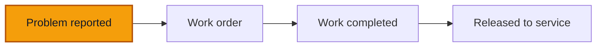

# Report a problem

**Goal** — Report a problem on a truck the way a driver does: once as an ordinary fault, once as safety-critical. Check that only the safety-critical one grounds the truck. Then see what a manager can do with a reported problem.

**Log in as** — the Driver (`sali`) for the reports. Then the Administrator (`boris`) for the steps after the report. The Technician (`herve`) and the Director can report too; Finance and the Cashier cannot. PINs are on [Access](/start-here/01-access).

## Where you are

The steps use VH001, which starts **Available**. Grounding a truck changes the counts that other testers read, so release it at the end of [Work orders](/daily-work/maintenance/03-work-orders).

## Steps

### An ordinary problem

1. Sign in as `sali`. Click **Trucks**, then the **Trucks** tab, then **VH001**.

> ✅ Expected: Sali's sidebar has **Dashboard**, **Trucks** and **Trips** only. VH001 has a green **Available** badge and the block **Available.** *In service since September 2021; last trip 3 months ago.* Top right: **Log fuel**, **Report a problem** and **More actions**. Her tabs are **Overview**, **Maintenance**, **Trips**, **Documents**, **Details** and **History**.

2. Click **Report a problem**.

> ✅ Expected: a panel **Report a problem**: *Describe the fault found on the truck. A safety-critical problem grounds the truck immediately.* It shows the truck (**VH001 · Douala**), then **Description**, **Category**, a **Safety-critical** box (*The truck is grounded from the moment this is filed until it is returned to service.*), **Photos (optional)**, **Cancel** and **Report the problem**. **Report the problem** is greyed out while the form is empty.

3. Open **Category**.

> ✅ Expected: **Bodywork**, **Brakes**, **Engine**, **Lighting**, **Other**, **Steering**, **Tyres**.

4. Write a **Description** (`Left mirror cracked after a branch scraped it`), pick **Bodywork**, leave **Safety-critical** unticked, and click **Report the problem**.

> ✅ Expected: a toast **Problem reported**. The truck stays **Available**.

5. Click the **Maintenance** tab.

> ✅ Expected: **Work orders 0** with *No work in progress. Plan one from a reported problem when something needs fixing.* Under **New problems 1**: your problem with its number (for example **PRB-0004**), **Bodywork**, **Not planned yet**, today's date and *now*. **Done** at the bottom folds the finished work orders and closed problems.

### A safety-critical problem

6. Click **Report a problem** again. Write `Steering pulls hard to the right above 60 km/h`, pick **Steering** and tick **Safety-critical**.

7. Click **Report the problem**.

> ✅ Expected: a toast **Problem reported**. The badge turns red: **Grounded**. The status block turns red: **Grounded since today — reported: "Steering pulls hard to the right above 60 km/h".** *Nobody has planned the repair yet: problem PRB-0005 has no work order.* For the Driver it adds *Do not drive it until a manager releases it to service.* On **Maintenance**, the new problem carries a red **Safety-critical** mark.

8. Click **⋯** on your ordinary problem (the mirror).

> ✅ Expected: the Driver has one action: **Mark as safety-critical**. She cannot plan, resolve or dismiss a problem.

### On a phone

9. Open VH001 at about 390 px wide and tap **Problem** in the floating bar.

> ✅ Expected: **Report a problem** opens as a sheet from the bottom, with the same fields and **Cancel** and **Report the problem** at the bottom.

### After the report

10. Sign in as `boris` (Administrator), open VH001 and click **Maintenance**. Click the mirror problem.

> ✅ Expected: a panel headed *Problem PRB-0004* with the description, **Not planned yet**, then **Category**, **Reported** (date, time and *by Sali*), **Photos** and **Work orders** (*None yet*). Under **Chronology**: *Problem reported*, Sali, with the time. A **History** button. At the bottom: **Create work order**, **Mark resolved**, **Dismiss the problem** and **Mark as safety-critical**.

11. Click **Mark resolved**, read the panel, then click **Cancel**.

> ✅ Expected: **Mark resolved**: *The problem has been dealt with, for example fixed on the spot. Resolving does not lift a grounding: only a return to service does.* An optional **Note**, **Cancel** and **Mark resolved**.

12. Open the problem again, click **Dismiss the problem**, read it, then click **Keep it open**.

> ✅ Expected: **Dismiss the problem**: *The problem should not have been raised: a mistake, a duplicate, nothing found. The reason stays on the audit trail.* **Reason** is required: **Dismiss the problem** stays greyed out until you write one.

13. Open the problem again, click **Mark as safety-critical**, read it, then click **Cancel**.

> ✅ Expected: *The vehicle is grounded as soon as you save, and stays grounded until a manager releases it to service.* **Cancel** and **Mark as safety-critical**.

14. Open **Maintenance** in the sidebar, then **Problems**, and click **⋯** on a safety-critical problem (for example **PRB-0001** on VH003).

> ✅ Expected: the last action reads **Remove the safety-critical mark**. Its panel says *The vehicle stays grounded: releasing it to service is a separate step. The reason stays on the audit trail.* **Remove the mark** needs a **Reason**. Click **Keep the mark**.

Leave the steering problem open. Plan its repair in [Work orders](/daily-work/maintenance/03-work-orders).

## Try to break it

- **Empty report.** Try to send with only a description, or only a category.
- **Grounded only once.** Mark a second problem safety-critical on a truck that is already grounded. The truck must stay grounded once, not twice, and History must say who did what.
- **Resolve does not release.** Resolve a safety-critical problem with no work order. The truck must stay **Grounded** until someone releases it to service.
- **Counts follow.** After each report, check the red count on **Maintenance** in the sidebar, the **New problems** tile, **Can drive** on the Trucks Overview and **Trucks that can drive** on the Dashboard.
- **Photos.** Attach a photo to a report from a phone. Then open the problem and check it is listed under **Photos**.
- **Roles.** As `nadege` (Finance) and `clarisse` (Cashier), open VH001. Neither should have **Report a problem** anywhere, including in **More actions**.

## Report it

Use the template in [Reporting bugs](/testing/reporting-bugs).

Next: [Work orders](/daily-work/maintenance/03-work-orders)
