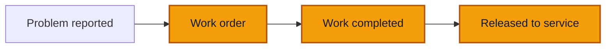

# Work orders

**Goal** — Plan the repair of a reported problem with a work order, complete the work with its real cost, and release the grounded truck to service. Check that completing the work alone never puts the truck back on the road.

**Log in as** — the Technician (`herve`) to open and complete the work order. Then the Administrator (`boris`) to release the truck. The Director can do both. PINs are on [Access](/start-here/01-access).

## Where you are

This page continues [Report a problem](/daily-work/maintenance/02-report-a-problem): VH001 is grounded by the safety-critical steering problem. With the demo's rules, a new work order opens **Approved** at once, so **Authorize work order** and **Sign off the work** stay locked in **More actions** (*Nothing waiting for authorization.*).

| Step | Who | Truck afterwards |
| --- | --- | --- |
| Create work order | Technician, Administrator, Director | **Grounded** |
| Complete work | Technician, Administrator, Director | **Waiting for release** (still grounded) |
| Release to service | Administrator, Director, never the person who completed the work | **Available** |

## Steps

### Open the work order

1. Sign in as `herve`. On **Maintenance**, click the **Problems** tab, then **⋯** on the steering problem (for example **PRB-0005**, VH001).

> ✅ Expected: **Create work order**, **Mark resolved** and **Dismiss the problem**. You can also start from the truck: the problem's panel, the **To do** row *Problem … has no work order*, the **Triage** button on the Maintenance Overview, or **More actions** → **Create work order**.

2. Click **Create work order**.

> ✅ Expected: a panel **Create work order**: *Open a work order on a truck, with or without a problem behind it.* **Truck** (VH001) and **Problem** (the steering problem) are filled in and fixed. Then **Description**, **Expected cost** in FCFA, **Cancel** and **Create the work order** (greyed out until the form is filled).

3. Write a **Description** (`Steering: check the box and tie rods, realign`), type `180000` in **Expected cost**, and click **Create the work order**.

> ✅ Expected: a toast **Work order opened**. On **Problems**, the steering problem now reads **In a work order** with the new number (for example **WO-0003**).

4. Open **Trucks** → **VH001**.

> ✅ Expected: still **Grounded**. The status block now says *Waiting on the workshop to finish the repair (WO-0003).* and, for the Technician, shows a **Complete work** button.

5. Click **Maintenance**, then click the work order.

> ✅ Expected: a panel headed *Work order WO-0003* and the description, with **Approved** and **Safety-critical** badges. A link **From problem PRB-0005**. A red note: *This work order keeps the vehicle grounded. Once it is completed, a manager releases it to service.* Then **Opened** (date, time, *by Hervé Mbarga*), **Expected cost** (180 000 FCFA), **Actual cost** (*Set when the work is completed*), **Costs** (*No costs posted against this work order.*), **Chronology** and **History**. At the bottom: **Complete work**, **Record expense** and **Cancel work order**.

**Record expense** here records parts or labour as an entry linked to this work order. See [Entries and recording](/daily-work/money/02-entries-and-recording).

### Complete the work

6. Click **Complete work**.

> ✅ Expected: the panel changes to **Complete work**, with a back link *Work order WO-0003*: *Say what was done and what the repair cost.* Fields: **Work summary**, then **How much did the repair cost?** in FCFA with *Expected: 180 000 FCFA · Repairs ·* and today's date under it, **Receipt photo (optional)** and **Add a line**. Two other answers: **No cost** and **Invoice not received yet**. A ticked box **Resolve the linked problem** (*Untick it if the work is done but the problem remains.*). **Complete work** is greyed out until the summary and the cost question are answered.

7. Write a **Work summary** (`Replaced the left tie rod end, realigned the front axle, road-tested 15 km`) and type `165000` in **How much did the repair cost?**.

8. Click **Complete work**.

> ✅ Expected: a toast **Work completed. Sent for review.** with *No receipt attached to this expense.* The cost is above the amount that posts directly (100 000 FCFA in the demo), so its entry waits for Finance. The panel now shows **Completed**, an amber note *The work is done, but the vehicle stays grounded until a manager releases it to service.*, **Actual cost** 165 000 FCFA, **Completed** with date and name, **What was done**, and under **Costs** the new entry marked **Awaiting review**.

9. Close the panel and click **Overview**.

> ✅ Expected: the badge reads **Waiting for release**. The status block turns amber: **Repair done — waiting for release to service.** *The repair (WO-0003) is completed; waiting on a manager to release it.* The Technician has no release button.

10. Click **More actions**.

> ✅ Expected: the Technician's **Maintenance** group holds **Report a problem**, **Create work order**, **Complete work** (locked, *No work order in progress.*) and **Cancel work order** (locked). There is no **Release to service** for him at all.

### Release to service

11. Sign in as `boris` and open VH001.

> ✅ Expected: the same amber block, now with a **Release to service** button. The **To do** card reads *Besides the repair above, what needs you on this vehicle.* and lists the missing receipt for the 165 000 FCFA entry.

12. Click **Release to service**.

> ✅ Expected: a panel **Release to service** with a back link *Work order WO-0003*: *The truck becomes available again. This decision needs someone other than whoever declared the work complete or closed the problem.* An optional **Note**, **Cancel** and **Release to service**.

13. Write a note (`Road test done with the driver, steering straight`) and click **Release to service**.

> ✅ Expected: a toast **Truck returned to service**. The badge turns green, **Available**, and so does the block. **Recent** lists **Released to service** and **Grounding lifted** by Boris, after **Work completed** and **Problem resolved** by Hervé.

14. Click **Maintenance**, then **Done**.

> ✅ Expected: **Work orders 0**. Under **Done**, the steering work order (**Completed**, 165 000 FCFA) and the older A/C repair. The mirror problem is still under **New problems**: one work order fixes one problem.

15. Sign in as `nadege` (Finance) and approve the 165 000 FCFA repairs entry, as in [Approve and reject](/daily-work/money/03-approve-and-reject).

> ✅ Expected: the entry is on Money's **To approve** tab as *Repairs · no receipt*, 165 000 FCFA. After you approve it, back on WO-0003, the cost line reads **Posted**.

### Cancel a work order

16. As `boris`, open VH003 → **Maintenance**, click **⋯** on **WO-0001**, then **Cancel work order**. Read the panel, then click **Keep work order**.

> ✅ Expected: **Cancel work order**: *The work order is abandoned. The reason stays on the audit trail.* **Reason** is required; **Cancel work order** stays greyed out until you write one. Do not cancel the demo's brake repair: other testers use it.

## Try to break it

- **Release too early.** Before the work is completed, open VH003 as `boris`. **Release to service** must be locked, with *Needs WO-0001 completed first.*
- **Release your own work.** As `boris`, complete a work order yourself, then try to release the truck. The release must be refused or locked: the person who completed the work cannot release it.
- **No cost.** Complete a work order with **No cost**. The order must show no cost line and no entry in Money.
- **Invoice later.** Complete a work order with **Invoice not received yet**. The order and the truck's **To do** should keep asking for the invoice until someone records it.
- **Several lines.** Use **Add a line** to split the cost into parts and labour. **Actual cost** must be the exact sum.
- **Resolve or not.** Untick **Resolve the linked problem** when completing. The problem must stay open, and the truck's page must still show it.
- **Counts follow.** After each step, check **Work orders open**, **Off the road** and **Repair cost** on the Maintenance Overview, and **Can drive** on Trucks and the Dashboard.
- **No money for the Technician.** Hervé sees expected and actual costs, never revenue, profit or loss.

## Report it

Use the template in [Reporting bugs](/testing/reporting-bugs).

Next: [Money — Overview](/daily-work/money/01-overview)
