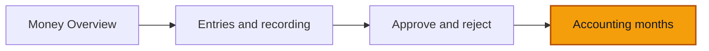

# Accounting months

**Goal:** lock a month so its posted figures stop changing, see what happens to a late entry dated in that month, and reopen the month with a reason.

**Log in as:** **Émilienne**, Director, in `transports-ngwa`. PINs are on [Access](/start-here/01-access). One check uses **Nadège** (Finance).

## Where you are

## The rules you are testing

- A month is one per company, not per branch. Locking it stops changes in every branch.
- After the lock, entries already posted in that month can no longer change.
- A late entry dated in a locked month still posts. It goes into the current open month and keeps its own date.
- The Director and Finance may lock a month. Only the Director may reopen one, and must give a reason.

## Steps

1. Click **Accounting months** in the sidebar, under **Company**.

> ✅ Expected: a page **Accounting months** with *Each month takes entries until finance locks it. Late corrections go into the open month.* The table has **Period**, **Status**, **Entries**, and a **⋯** button per row. In the demo: **2026-10**, **2026-09** and **2026-07**, all **Open**. Months with no entries (August) are not listed.

*Each month that holds entries has one row.*

2. Open the **⋯** menu on **2026-09** and click **Lock period**.

> ✅ Expected: a dialog **Lock period** with *Entries already posted in this month can no longer change. A late entry dated in this month posts in the current month and keeps its date.* and **Cancel** / **Lock period**.

*The lock dialog says what will stop and what still works.*

3. Click **Lock period**.

> ✅ Expected: a toast **Period locked**. The row reads **Locked since 11 October 2026** (today's date).

*A locked month shows since when.*

4. Open **Money** → **Overview**.

> ✅ Expected: the tile **September 2026 close** reads **Locked**. The **Close September 2026** item has left **To do**.

*Once September is locked, its tile says so and its To do item goes.*

### A late entry

5. Sign in as **Nadège** (Finance). Click **Record expense**, pick **Tolls**, type `20000`, and set **Date** to `15/09/2026`. Click **Record the expense**.

> ✅ Expected: the entry is saved. The toast reads **Entry recorded and posted** with *The month of this date is locked, so the entry was posted in the current month. It keeps its own date.*

*A late entry is accepted and posted into the open month.*

6. Open **Accounting months** as Nadège.

> ✅ Expected: open months still have a **⋯** menu. The locked **2026-09** row has none: Finance may lock but not reopen.

*Finance sees no action on a locked month.*

### Reopen

7. Sign back in as **Émilienne**. On **2026-09**, open **⋯** and click **Reopen period**.

> ✅ Expected: the menu offers only **Reopen period**. A dialog **Reopen period** asks for **Reason for reopening**, with **Cancel** / **Reopen period**.

*Reopening needs a reason.*

8. Type `Late fuel receipt from Garoua to record` and click **Reopen period**.

> ✅ Expected: a toast **Period reopened**, and the row reads **Open** again.

## Try to break it

- **Reopen with no reason.** Leave **Reason for reopening** empty. **Reopen period** must not go through.
- **Change a locked entry.** Lock a month, then open a posted entry dated in it and click **Cancel entry**. Write down what happens and in which month the cancellation lands.
- **Approve into a locked month.** Lock a month that holds an entry **Awaiting review**, then approve it. Write down the toast and where it posts.
- **Lock twice.** Open the page in two tabs and lock the same month in both. Expect a refusal or a refresh, never an error page.
- **Branch-limited Finance.** The roles table leaves open whether a Finance member limited to some branches may lock the whole company's month. If you have such an account, try it and report what happens.
- **Month names.** The list shows months as **2026-09**, while tiles say **September 2026**. Note it if you find it confusing.

## Report it

Use [Reporting bugs](/testing/reporting-bugs). Give the month, who you were, what you clicked, and the exact toast.
