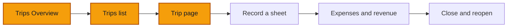

# Trips: the page and the list

**Goal:** find your way around **Trips**: the Overview tab, the Trips list, and one trip's own page. You change nothing on this page.

**Log in as:** **Boris**, Administrator, all branches, in `transports-ngwa`. PINs are on [Access](/start-here/01-access). Later steps switch to **Sali** (Driver) and **Clarisse** (Cashier) to compare.

## Where you are

## Who sees Trips

| Role | Trips in the sidebar | Record a sheet | What they see |
| --- | --- | --- | --- |
| Director, Administrator | Yes | Yes | Every trip in their branches, with Money |
| Finance | Yes | No | Every trip, with Money, no buttons |
| Driver | Yes | Yes | Only their own trips |
| Cashier, Technician | No | No | No sidebar row |

## Steps

### The Overview tab

1. Click **Trips** in the sidebar, under **Daily work**.

> ✅ Expected: the page header reads **Trips** with the line *Every trip your trucks run, from start to close.* and a **Record a sheet** button on the right. Two tabs sit under it: **Overview** (selected) and **Trips**.

*Trips opens on Overview: a summary notice, five tiles, a weekly chart, the To do card and revenue per km by route.*

2. Read the notice at the top. It starts with **Something changed** and a date, and has a close button (**×**) on the right.

> ✅ Expected: the notice says what changed this week in one sentence, for example *No trip has started this week yet.*, with a smaller line under it about trips still open or grounded trucks. A thin line at the bottom names closed trips missing data.

3. Read the five tiles: **Closed this week**, **On the road**, **Km this week**, **Km driven empty** and **Closed with missing data**.

> ✅ Expected: **On the road** shows the number of open trips and, under it, *Oldest started* with a date such as *29 July 2026*. **Km this week** reads **Not recorded** when no closed trip this week has km. **Closed with missing data** shows a count and *without fuel · without km* under it.

4. Look at **Trips per week** (*Is the work growing? Started and closed, last 12 weeks.*) and the **To do** card (*What is left to close*).

> ✅ Expected: the chart has two bar colours, **Closed** and **Still open**, one bar pair per week. **To do** lists items such as **1 still open** (naming the oldest trip, its truck and start date) and **1 closed without fuel**. Each item has **Open the list**.

5. Scroll to **Revenue per km by route** (*Which routes pay best?*).

> ✅ Expected: one bar per route, for example **Douala - Garoua**, with the trip count and a figure in **FCFA** per km. Routes with no revenue are named under the chart after *Not counted, no revenue recorded:*. A **Table** button shows the same numbers as a table.

### The Trips list

6. Click the **Trips** tab.

> ✅ Expected: the address ends in `/activities/list`. Filters sit above the table: **Status**, **Completeness**, **Missing**, **Trip type**, **Truck**, then **From** and **To** dates. A **View** button on the right picks the columns.

*The Trips tab lists every trip with its number, status, type, dates, truck, customer, legs and crew.*

7. Read the columns: **Trip no.**, **Status**, **Type**, **Started**, **Ended**, **Primary truck**, **Customer**, **Legs**, **Crew**.

> ✅ Expected: the status badge is one of **On the road**, **Closed**, or **Closed, N gaps** (for example **Closed, 5 gaps**). A trip still open shows **Not recorded** under **Ended**. Dates in the list are short, such as *29 Jul 2026*.

8. Open each filter and read its choices.

> ✅ Expected: **Status** offers **All**, **On the road**, **Closed**. **Completeness** offers **All**, **Complete**, **Closed with exceptions**. **Missing** offers **All**, **No fuel**, **No km**. **Truck** lists the truck codes (TR001, VH001, VH003).

9. Open the **⋯** menu at the end of a row.

> ✅ Expected: one item, **Open trip**.

### One trip's page

10. Click the trip number **DLA-2026-00003** (status **On the road**).

> ✅ Expected: the trip's own page opens. The header shows the number, the **On the road** badge and one facts line: *Haulage job · Yaoundé Wholesale · Douala → Yaoundé · 29 July 2026*. Buttons on the right: **Add a leg**, **Record odometer**, **Record expense**, **Substitute asset**.

*An open trip: the yellow status block holds the next step, Close the trip.*

11. Read the yellow status block under the header.

> ✅ Expected: **On the road** *Close it when it is back; gaps are flagged, never invented.* with a dark **Close the trip** button.

12. Read the tabs and the right-hand column.

> ✅ Expected: tabs **Overview**, **Legs** (with a count), **Money**, **History**, in that order. Overview shows four tiles (**Started**, **Ended**, **Distance**, **Legs**) and the cards **Truck and crew**, **Job** and **Planned vs actual**. Empty facts read **Not recorded**. The right column has **Money** (**Profit** or **Loss**, **Revenue**, **Expenses**, *posted only*, **Open the tab**), **Linked** (the truck code) and **Latest** (recent history, **All history**).

13. Go back to the list and open **DLA-2026-00002** (**Closed, 5 gaps**).

> ✅ Expected: the status block is yellow with a warning icon: **Closed, but 5 things are missing** and *Its profit can't be trusted until they are added: reopen it, add them, close it again.* Chips name what is missing, such as **No crew recorded**, **No revenue attributed**, **Start meter reading missing**. The button is **Complete the trip**. The right column shows **Loss** because the trip has an expense and no revenue.

*A trip closed with gaps keeps them on the record; Complete the trip starts the fix.*

14. Open the **Legs** tab, then the **Money** tab.

*Legs lists each leg of the trip.*

> ✅ Expected: the address gets `?tab=legs`, then `?tab=money`. **Money** lists each entry on the trip (number, category, status badge, signed amount) and ends with **Profit** or **Loss** marked *posted only*.

*The Money tab counts posted entries only; the result is shown as Loss when expenses are higher.*

### Other roles

15. Sign out and sign in as **Sali** (Driver). Open **Trips**.

> ✅ Expected: the list holds only Sali's trips (in the demo, DLA-2026-00002 and DLA-2026-00003). On a closed trip with gaps the status block ends with *a manager reopens it.* and there is no button. The right column has no **Money** card.

*A driver sees their own closed trip without Reopen or Money.*

16. Sign in as **Clarisse** (Cashier).

> ✅ Expected: the sidebar has **Dashboard**, **Trucks** and **Money**. There is no **Trips** row.

### On a phone

17. Open **Trips** on a phone, or narrow the browser to 390 px wide.

> ✅ Expected: the list becomes rows, not a table: trip number on top, *type · date · truck* under it, the status badge on the right, and **⋯**. The filters fold into one **Filters** button. A bottom bar shows **Dashboard**, **Trucks**, **Money**, **Menu**.

*On a phone each trip is one row; filters fold into one button.*

18. Open a trip on the phone.

> ✅ Expected: the header buttons wrap under the title. The main action (**Close the trip**) sits in a bar at the bottom of the screen, above the bottom bar. The **Money** card comes first on Overview.

*On a phone the next step stays at the bottom of the screen.*

## Try to break it

- **Close the notice.** Click **×** on the Overview notice, then reload. Note whether it stays closed. Report what you see.
- **Follow every link.** Click each tile and each **Open the list** on Overview. The list that opens must show the trips the tile counted. A tile that says 1 and a list that shows 0 is a bug.
- **Filter to nothing.** Pick **Completeness: Complete** and **Missing: No fuel** together. Expect an empty list with a clear message, not an error.
- **Type a link you should not have.** As **Clarisse** (Cashier) or **Hervé** (Technician), type `/activities` in the address bar. Write down what opens. Neither role has a Trips row, so report it if the page opens.
- **Narrow the branch.** As **Amadou** (Administrator, Yaoundé), open Trips. Expect zero trips and empty tiles, since the demo trips belong to Douala.

## Report it

Use [Reporting bugs](/testing/reporting-bugs). Give the trip number, the tab you were on, and a screenshot.
