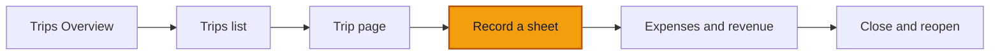

# Record a trip sheet

**Goal:** copy one paper trip sheet into ROUTIQ, from references down to money, and land on the new trip's page.

**Log in as:** **Boris**, Administrator, all branches, in `transports-ngwa`. PINs are on [Access](/start-here/01-access). One step at the end switches to **Sali** (Driver).

## Where you are

## The rule you are testing

The form follows the paper sheet from top to bottom. Only five fields are required: **Branch**, **Trip type**, **Primary truck**, **Departure** and **Arrival**. Everything else may stay empty. Missing facts are flagged later on the trip, never invented.

## Before you start

Use truck **VH001**. It is in service and has no open trip. VH003 is grounded and already on the road in the demo.

## Steps

1. Open **Trips** and click **Record a sheet**.

> ✅ Expected: a full page titled **Record a sheet** with the line *Work down the paper sheet from top to bottom. Anything it does not say can stay empty.* The main column holds the cards **References**, **Vehicle and meters**, **Crew**, **Legs**, **Cargo**, **Revenue and expenses**. The right column holds **So far** and **Still missing**. A bar along the bottom shows **5 missing**, **Record and close** and **Record sheet**.

*The sheet starts empty; Still missing lists the five required fields with a Go link each.*

2. Click **Record sheet** without filling anything.

> ✅ Expected: nothing is saved. **Branch**, **Trip type**, **Primary truck**, **Departure** and **Arrival** turn red with *This field is required.* under each. The **References** card shows **2 missing** and **Vehicle and meters** shows **3 missing**.

*An empty submit marks the five required fields and sends nothing.*

3. In **References**: pick **Douala (DLA)** for **Branch** and **Haulage job** for **Trip type**. Type `Yaoundé Wholesale` in **Customer (optional)** and `YW-1009` in **Client ref. (optional)**.

> ✅ Expected: the **References** badge changes to **Done**, and **Still missing** drops the two items.

4. In **Vehicle and meters**: pick **VH001** in **Primary truck**. Type `09/10/2026 07:00` in **Departure** and `09/10/2026 16:30` in **Arrival**.
5. Click **Add meter readings**. Type `212400` in **Reading at departure** and `212645` in **Reading at arrival**. Leave both **Unit** fields on **Odometer**.

> ✅ Expected: the card shows **Done**. **So far** shows **Truck VH001**. **Still missing** reads **Nothing missing**, and so does the bottom bar. A **Trailer** line says *No extra asset.* with **Add an asset**.

*With the five required fields filled, Still missing reads Nothing missing.*

6. In **Crew**: click the **Person** box and pick **Jean Ngwa**. Leave **Role** on **Driver**.

> ✅ Expected: the list offers people with their usual role under the name (Jean Ngwa, Sali, each marked *Driver*). **Add a crew member** adds another row.

*The person picker lists people who can be crew, with their usual role.*

7. In **Legs**, leg 1: type `Douala` in **From** and pick it from the suggestion. Type `Yaoundé` in **To** and pick it. Type `245` in **Distance (km)**. Pick **Laden** in **Load**.

> ✅ Expected: known places appear as suggestions while you type. Each end has a **One-off stop** box for a place not on the list. **Load** offers **Laden**, **Empty**, **Partial**. **So far** now shows **Route Douala → Yaoundé** and **Distance 245 km**.

8. In **Cargo**: type `Bagged cement` in **Cargo** and `28000` in **Weight (kg)**.

*Leg 1 filled; So far shows the route and the distance.*

9. Leave **Revenue and expenses** for now. [Expenses and revenue](./03-expenses-and-revenue) covers it. If you want a profit on the trip, add the two lines from that page first.
10. Click **Record sheet** (not **Record and close**).

> ✅ Expected: a toast **Sheet recorded**, and the new trip's page opens (in a fresh demo, **DLA-2026-00004**). The badge reads **On the road**. Overview shows your times, **245 km**, **1** leg, **VH001**, **Jean Ngwa · Driver**, both meter readings, **Yaoundé Wholesale** and **YW-1009**. **Latest** shows **Sheet recorded** by Boris.

*The recorded sheet opens as an open trip; the toast names any warnings.*

11. Open **Trips** → **Trips** tab.

> ✅ Expected: the new trip is in the list with **On the road**, **VH001**, **1** leg and **1** crew.

### The driver's sheet

12. Sign in as **Sali** (Driver) and open **Record a sheet**. Scroll to the bottom card.

> ✅ Expected: the last card is called **Expenses**, not **Revenue and expenses**. It says *No expense on this sheet yet.* and offers **Add expense** only. **So far** has no **Revenue** or **Profit** line. Prices are the office's job.

*Drivers record expenses on the sheet, never revenue.*

### On a phone

13. Open **Record a sheet** on a phone (or at 390 px wide).

> ✅ Expected: one card per step. The top reads **Step 1 of 7** **References**. The bottom bar shows the missing count and **Next**. **Record sheet** is on the last step.

*On a phone the sheet is a series of steps.*

## Try to break it

- **Arrive before you leave.** Put **Arrival** earlier than **Departure** and submit. Expect *Arrival must come after departure.* on **Arrival**.
- **Half a leg.** Fill **From** and leave **To** empty, then submit. Expect *Give both ends of this leg.* A leg you never touched is dropped without an error.
- **Half a leg, then empty it.** After the error above, delete what you typed in **From** and submit again. In the October 2026 build the **From** label stays red and nothing happens: no save, no message, while the bottom bar says **Nothing missing**. Removing the leg with its bin button unblocks the sheet. This is a known problem; report it again if you still see it.
- **Blank crew row.** Click **Add a crew member** and leave it empty. Expect the sheet to save with only the crew you filled.
- **Use the Go links.** With fields missing, click **Go** next to an item in **Still missing**. The page must scroll to that field.
- **A truck that is busy.** Pick **VH003**, which is grounded and already on another open trip. Write down what the sheet says. A silent save of a grounded truck on a second open trip is worth a report.
- **Record twice.** After **Record sheet**, press the browser's Back button and click **Record sheet** again. Expect no second trip with the same details. If you get one, report it with both trip numbers.
- **Record and close.** Fill only the five required fields and click **Record and close**. Expect the toast **Sheet recorded and trip closed** listing what is missing, and a trip page with **Closed, 5 gaps**. See [Close and reopen](./04-close-and-reopen).

## Report it

Use [Reporting bugs](/testing/reporting-bugs). Give the field name, what you typed, and what the sheet said.
