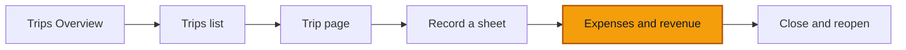

# Expenses and revenue on a trip

**Goal:** put money on a trip two ways (on the sheet, and from the trip page), and watch which lines count in the trip's profit and which wait for approval.

**Log in as:** **Boris**, Administrator, all branches, in `transports-ngwa`. PINs are on [Access](/start-here/01-access).

## Where you are

## The rule you are testing

- An entry up to **100 000 FCFA** posts at once. Above that it waits for Finance. Above **1 000 000 FCFA** it waits for the Director. The form says which before you save. (Direction and Administrators move these amounts in [Company settings](/company/company-settings).)
- The trip's **Profit** counts **posted** entries only. Lines waiting for approval are listed, but stay out of it.
- When expenses are higher than revenue, ROUTIQ shows a **Loss**, never a negative profit.
- Amounts are whole FCFA. There are no centimes.

## Steps

### On the sheet

1. Start a sheet as in [Record a sheet](./02-record-a-sheet), steps 1 to 8, and scroll to **Revenue and expenses**.

> ✅ Expected: *No revenue or expense on this sheet.* with two buttons, **Add revenue** and **Add expense**.

2. Click **Add revenue**. Pick **Freight revenue** in **Category** and type `450000` in **Amount (FCFA)**.

> ✅ Expected: the line has a **Revenue** / **Expense** switch at the top with **Revenue** selected. Fields: **Category**, **Amount (FCFA)**, **Payment method** (on **Cash**), **Counterparty (optional)**, **Detail (optional)**, **Reference (optional)**, **Asset (optional)**, **Person (optional)**. A ticked box **Charge to this trip** has the hint *Clear this when the money belongs to the asset rather than the trip: a repair stays off the sheet.*

3. Click **Add expense**. Pick **Fuel** and type `60000`.

> ✅ Expected: the revenue category list holds only revenue categories (**Freight revenue**). The expense list holds only expense categories (**Driver allowance**, **Fuel**, **Insurance**, **Loading**, **Parking**, **Repairs**, **Tolls**). **So far** shows **Revenue 450 000 FCFA**, **Expenses 60 000 FCFA** and **Profit 390 000 FCFA**.

*So far adds up the sheet's lines as you type, before anything is approved.*

4. Click **Record sheet**.

> ✅ Expected: a toast **Sheet recorded** with extra lines: *No receipt attached to this expense.* and *1 line awaiting approval*. On the new trip, the right column shows **Loss 60 000 FCFA**, **Revenue Not recorded**, **Expenses 60 000 FCFA**, *posted only*. The 450 000 FCFA revenue is above 100 000 FCFA, so it waits; the 60 000 FCFA fuel posted.

5. Open the trip's **Money** tab.

> ✅ Expected: the card **Revenue and expenses** lists the revenue with an **Awaiting review** badge and **+450 000 FCFA**, and the fuel with **Posted** and **−60 000 FCFA**. Under the line: **Loss** *posted only* in red, then **Awaiting approval +450 000 FCFA** and *Lines awaiting approval are listed but stay out of the profit.*

### From the trip page

6. On the same trip, click **Record expense** in the header.

> ✅ Expected: a side panel **Record expense**. **Truck** is filled in and greyed (the trip's truck). **Branch** is filled in. Fields: **Category**, **Amount (FCFA)**, **Payment method**, **Date**, **Counterparty (optional)**, **Description (optional)**, **Payment reference (optional)**, **Supporting document (optional)**. Under **Amount** the hint reads *Above 100 000 FCFA, this entry waits for Finance. Above 1 000 000 FCFA, this entry waits for the Director.* **Record the expense** is greyed until the form is complete.

7. Pick **Tolls**, type `15000` in **Amount (FCFA)** and `Péage Edéa` in **Counterparty (optional)**.

> ✅ Expected: the hint under **Amount** changes to *At this amount, the entry posts directly.*

*The hint under Amount tells you before you save whether the entry posts or waits.*

8. Click **Record the expense**.

> ✅ Expected: a toast **Entry recorded and posted**. The **Money** tab now has a third line, **Tolls** **Posted** **−15 000 FCFA**, and the **Loss** grows to **75 000 FCFA** in the card and in the right column.

*Posted expenses move the result at once; the waiting revenue does not.*

9. Sign in as **Nadège** (Finance) and approve the 450 000 FCFA revenue from **Money** → **To approve** (see [Approve and reject](../money/03-approve-and-reject)). Come back to the trip.

> ✅ Expected: the revenue line now reads **Posted**, and the result turns from **Loss** into **Profit**: 450 000 − 60 000 − 15 000 = 375 000 FCFA. The right column shows **Revenue 450 000 FCFA**.

### Other trip actions

These buttons sit next to **Record expense** on an open trip. Open each one, read it, and press **Cancel**.

- **Add a leg**: a side panel *Leg no. 2 of this trip.* with **From**, **To**, **Departure time (optional)**, **Arrival time (optional)**, **Distance in km (optional)**, **Load (optional)**, **Asset on this leg (optional)** and **Record the leg**.
- **Record odometer**: *A reading stays as it was captured; a correction adds a new row.* with **Asset**, **Unit** (**Odometer**), **Value**, **Reading date and time** and **Record the reading**.
- **Substitute asset** (shown when another truck could take over): *The outgoing asset stops at the handover; the replacement carries on from there.* with **Outgoing asset**, **Replacement asset**, **Handover date and time**, two optional meter readings, **Reason (optional)**.

*Add a leg numbers the new leg for you.*

## Try to break it

- **Centimes.** Type `4500,50` in an amount. Expect **Please enter a number.** and no save.
- **Zero.** Type `0` in the **Record expense** panel. Expect **Please enter a number.** Try `0` on a sheet line too: it must not save a zero line.
- **Wrong side.** Switch a sheet line from **Revenue** to **Expense** after picking a category. The category list must reload; a revenue category must never stay on an expense.
- **Untick Charge to this trip.** Record a repair line with **Charge to this trip** cleared. Expect the money to land on the truck, not in the trip's **Money** tab. Check the truck's **Money** tab.
- **The threshold edge.** Type exactly `100000`. Expect *At this amount, the entry posts directly.* Then `100001`. Expect the wait message. Record both and check that only the second waits.
- **As a driver.** Sign in as **Sali** on one of Sali's open trips. **Record expense** must be there, but there is no way to add revenue.
- **Asset words.** On a trucking company, some labels still say *asset* or *vehicle* (**Substitute asset**, **Asset on this leg (optional)**, **Asset (optional)**, *Assign to a vehicle…*). Note any screen that mixes the words.

## Report it

Use [Reporting bugs](/testing/reporting-bugs). Give the trip number, the entry number, the amount, and what the trip's **Money** tab showed.
