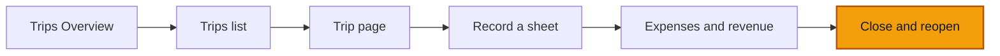

# Close and reopen a trip

**Goal:** close a trip, read what the close says about missing data, then reopen it with a reason and find that reason in the trip's history.

**Log in as:** **Boris**, Administrator, all branches, in `transports-ngwa`. PINs are on [Access](/start-here/01-access). One check uses **Sali** (Driver).

## Where you are

## The rule you are testing

Closing **warns, it does not block**. A trip with missing facts still closes. ROUTIQ names each missing fact on the trip (**No crew recorded**, **No revenue attributed**, **Start meter reading missing**…) and counts them in the badge, for example **Closed, 4 gaps**. Nothing is invented to fill the gap.

Reopening needs a reason. The reason stays in the trip's history.

## Steps

### Close a complete trip

1. Open the trip you recorded in [Record a sheet](./02-record-a-sheet) (in a fresh demo, **DLA-2026-00004**). The badge reads **On the road**.
2. Click **Close the trip** in the yellow status block.

> ✅ Expected: a dialog **Close the trip** with *Anything missing is flagged on the record, never invented.*, a field **End date and time (optional)** and **Note (optional)**, then **Cancel** and **Close the trip**. The end date is optional because the sheet already has an **Arrival**.

*When the sheet has an arrival time, the end date is optional.*

3. Type `Back in Douala, sheet handed in.` in **Note (optional)** and click **Close the trip**.

> ✅ Expected: a toast **Trip closed**. The badge changes to **Closed** (green). The facts line ends with *Closed* and the date and time. The yellow block and the buttons **Add a leg**, **Record odometer**, **Record expense** are gone. The only button left is **Reopen the trip**.

*A complete trip closes green; no capture buttons remain.*

### Close a trip with gaps

4. Open **DLA-2026-00003** (on the road since 29 July 2026, no meter readings, no revenue). Click **Close the trip**.

> ✅ Expected: this time the field reads **End date and time** with no *(optional)*, because the trip has no arrival yet. **Close the trip** stays greyed while it is empty.

*A trip with no arrival needs an end date to close.*

5. Type `30/07/2026 17:40` in **End date and time** and click **Close the trip**.

> ✅ Expected: the toast **Trip closed** lists what is missing: *No revenue attributed*, *Start meter reading missing*, *End meter reading missing*, *An open segment was closed automatically*. The badge reads **Closed, 4 gaps**. The status block says **Closed, but 4 things are missing** with the same items as chips, and a **Complete the trip** button.

*The close succeeds; each missing fact is named on the trip.*

6. Click **Complete the trip**.

> ✅ Expected: it opens the same **Reopen the trip** dialog as step 8. Completing a trip means reopening it, adding what is missing, and closing it again. Press **Cancel**.

### Record and close in one go

7. From **Record a sheet**, fill only **Branch**, **Trip type**, **Primary truck**, **Departure** and **Arrival**, then click **Record and close**.

> ✅ Expected: the toast **Sheet recorded and trip closed** lists five gaps (**No legs recorded**, **No crew recorded**, **No revenue attributed**, **Start meter reading missing**, **End meter reading missing**). The trip opens with **Closed, 5 gaps**.

*Record and close saves the sheet already closed, with its gaps named.*

### Reopen

8. Go back to the complete trip from step 3 and click **Reopen the trip**.

> ✅ Expected: a dialog **Reopen the trip** with *Reopening clears the completeness verdict. The reason stays in the audit trail.*, a **Reason** box with the placeholder *Why reopen this trip?*, and **Cancel** / **Reopen the trip**. The button stays greyed while **Reason** is empty.

*Reopening always asks why.*

9. Type `Toll receipt for the return leg came in late.` and click **Reopen the trip**.

> ✅ Expected: a toast **Trip reopened**. The badge goes back to **On the road**, the yellow block and **Close the trip** come back, and so do **Add a leg**, **Record odometer** and **Record expense**.

*A reopened trip takes capture again.*

10. Reload the page and open the **History** tab.

> ✅ Expected: newest first, under **Today**: **Trip reopened** with your reason quoted, **Trip closed** with your note quoted, **Sheet recorded**. Each shows who and when (*Boris · 03:22*), chips for the fields that changed, and **Show changes**. **Latest** in the right column lists the same three.

*History keeps the close note and the reopen reason, word for word.*

11. Close the trip again so the next tester finds it tidy.

### Who may close and reopen

12. Sign in as **Sali** (Driver) and open **DLA-2026-00003** while it is still open (reseed the demo if you closed it).

> ✅ Expected according to the [roles table](/start-here/02-accounts): a driver may close their own trip, but not reopen it. On a closed trip with gaps, Sali sees *a manager reopens it.* and no button.

*In the October 2026 build a driver on their own open trip has no Close the trip button, though the status block says to close it.*

## Try to break it

- **History after closing.** Close a trip and open **History** straight away, without reloading. In the October 2026 build the new event does not appear until you reload. Check whether this still happens.
- **Reopen with spaces.** Type only spaces in **Reason**. **Reopen the trip** must stay greyed.
- **End before start.** Close a trip with an **End date and time** earlier than its start. Write down what happens.
- **Two tabs.** Open the same open trip in two tabs. Close it in the first, then try to close it in the second. Expect a refusal or a refresh, never a second close.
- **Reopen as Finance.** Sign in as **Nadège** (Finance) and open a closed trip. Expect no **Reopen the trip** button.
- **Add after close.** On a closed trip, look for any way to add a leg, a reading or an expense. There must be none until it is reopened.

## Report it

Use [Reporting bugs](/testing/reporting-bugs). Give the trip number, its badge before and after, and a screenshot of the **History** tab.
