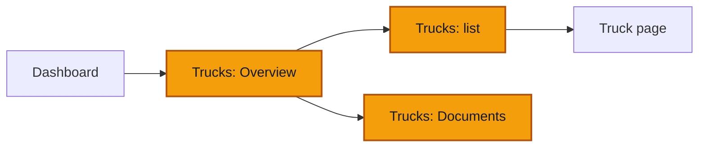

# Trucks — Overview and list

**Goal** — Read the Trucks page: how many trucks can drive today, which are grounded, which papers are due, and find any truck in the list.

**Log in as** — the Administrator (`boris`). Then the Technician (`herve`), the Driver (`sali`), the Cashier (`clarisse`) and the Administrator for Yaoundé (`amadou`) for the role checks. PINs are on [Access](/start-here/01-access).

## Where you are

## Who sees what

| Role | Tabs | Also |
| --- | --- | --- |
| Director, Administrator | **Overview**, **Trucks**, **Documents** | **Register a truck** button, **Profit by truck** card |
| Finance | **Overview**, **Trucks**, **Documents** | **Profit by truck** card, no **Register a truck** |
| Technician | **Overview**, **Trucks**, **Documents** | No profit, no **Register a truck** |
| Cashier, Driver | **Overview**, **Trucks** | No documents, no profit. An **Attention** tile replaces **Documents due ≤ 30 days** |

The numbers below come from the demo seed. Dates move with the day the workspace was seeded, so read "8 October" as "a few days ago".

## Steps

### The Overview

1. Click **Trucks** in the sidebar.

> ✅ Expected: the page title is **Trucks**, with the line *Track every truck from registration through retirement.* Three tabs: **Overview**, **Trucks** and **Documents**. The **Register a truck** button is top right. The page opens on **Overview**.

2. Read the summary card at the top.

> ✅ Expected: a small heading such as **Something changed · Sunday 11 October**, one bold sentence (*Can drive today: 1 of 3 trucks.*), a badge on the right (**1 grounded**) and a second sentence (*VH003 was grounded on 8 October and is still off the road.*). Under a thin line: *In service and not grounded today.* The cross at the top right closes the card.

3. Read the five tiles.

> ✅ Expected:
> - **Can drive**: **1** *of 3*. A truck can drive when it is in service and not grounded. This is the same count as **Trucks that can drive** on the [Dashboard](/daily-work/dashboard).
> - **Grounded**: **1**, *VH003 · 2 days*.
> - **On the road, last 30 days**: a percentage, with the change against the 30 days before and the number of days not recorded.
> - **Documents due ≤ 30 days**: **1**, *First: VH003 · 23 October 2026*.
> - **No trip for 5+ days**: **1**, *VH001 · 81 days*.
>
> Under the tiles: *This month, km are known for every truck (3).*

4. Click the **Grounded** tile.

> ✅ Expected: the **Trucks** tab opens with **Grounded** picked in the **Availability** filter and **Clear filters** next to it. Only VH003 is listed. The breadcrumb reads **Dashboard › Trucks › List**.

5. Go back to **Overview** and scroll down.

> ✅ Expected, in this order:
> - **Fleet board**: *What did each truck do, day by day? Last 30 days.* One row per truck, one square per day, coloured **On a trip**, **Available, no trip**, **In the workshop**, **Grounded** or **Not recorded**. *Point at a day to read it.* **Table** shows the same days as a table with an **On the road** column. **Open the list** opens the **Trucks** tab.
> - **Documents and services due**: *Expired, and due in the next 30 days.* For example *VH003 · Visite technique, Expired 8 October 2026 · 3 days ago* and *VH003 · Insurance, 23 October 2026 · in 12 days*, each with **Renew**. A note says *Services by km are not counted: no service interval is recorded per vehicle yet.* Then **Open Documents**.
> - **Profit by truck**: *Which earn, which lose?* and the period (for example *1–11 October*). Each truck shows its closed trips, its km and **Profit … FCFA**. Under it: *Revenue minus expenses recorded on the vehicle*, and **Open Money**.

6. Click **Renew** on the **Visite technique** row.

> ✅ Expected: VH003 opens on its **Documents** tab with the Visite technique panel open on the right. Renewing is covered in [The truck page](/daily-work/trucks/03-truck-page#documents).

### The list

7. Click the **Trucks** tab.

> ✅ Expected: a search box *Code, plate or model…*, three filters and a **View** button. The table has the columns **Truck**, **Status**, **Class**, **Branch** and **Plate**, and a **⋯** menu on each row. The seed holds three trucks: **TR001** (**Registered**, Trailer, no plate), **VH001** (**In service**, Truck, no plate) and **VH003** (**In service**, Truck, **LT 482 AB**), all in Douala. A missing plate reads **Not recorded**.

8. Open each filter.

> ✅ Expected:
> - **Status**: **All**, **In service**, **Needs attention**.
> - **Availability**: **All**, **Can drive**, **Grounded**, **No trip for 5+ days**.
> - **Class**: **All**, **Trailer**, **Truck**.
>
> **View** lets you hide or show the **Status**, **Class**, **Branch** and **Plate** columns.

9. Type `LT 482` in the search box.

> ✅ Expected: only VH003 is left. Clear the box and all trucks come back.

10. Click **⋯** on the **TR001** row.

> ✅ Expected: a menu with **Open asset record**, **Documents**, **Commission** and **Transfer home branch**. On a truck already in service, such as VH001, **Commission** is not offered.

11. Press Escape, then click **VH003** in the first column.

> ✅ Expected: the truck page for VH003 opens. See [The truck page](/daily-work/trucks/03-truck-page).

### The Documents tab

12. Go back to **Trucks** and click the **Documents** tab.

> ✅ Expected: three choices, **All**, **Expired** and **Due in 30 days**, and a table with **Vehicle**, **Document**, **Expires** and **State**. The seed shows two rows: *VH003 · Visite technique · 8 Oct 2026 · Expired 3 days ago* and *VH003 · Insurance · 23 Oct 2026 · Due in 12 days*. Under the table: *2 rows loaded*. Clicking **VH003** opens the truck.

### On a phone

13. Open **Trucks** on a phone, or in a window about 390 px wide.

> ✅ Expected: the same three tabs. The filters fold into one **Filters** button. Each truck is one row with its code, class and branch, and its status on the right. A round **+** button at the bottom right registers a truck. The bottom bar shows **Dashboard**, **Trucks**, **Money** and **Menu**.

### Other roles

14. Sign in as `herve` (Technician) and open **Trucks**.

> ✅ Expected: the same tiles and **Documents and services due**, but no **Profit by truck** card and no **Register a truck** button. No amount of revenue or profit anywhere.

15. Sign in as `sali` (Driver), then `clarisse` (Cashier), and open **Trucks**.

> ✅ Expected: only **Overview** and **Trucks** tabs. The fifth tile is **Attention** (*Grounded, in maintenance, retired or written off*) instead of **Documents due ≤ 30 days**. No **Documents and services due** card, no **Profit by truck**, no **Register a truck**.

16. Sign in as `amadou` (Administrator, Yaoundé only) and open **Trucks**.

> ✅ Expected: the header shows **Yaoundé**. The demo has no truck in Yaoundé, so **Can drive** reads **0** *of 0*, **Grounded** reads *None off the road*, **Documents due ≤ 30 days** reads *Nothing due* and the list is empty. If another tester transferred a truck to Yaoundé, you see that truck only.

## Try to break it

- **Tile and list disagree.** Click each tile that is a link (**Can drive**, **Grounded**, **Documents due ≤ 30 days**, **No trip for 5+ days**). The list it opens must hold exactly the trucks the tile counts.
- **Two counts for one fact.** **Can drive** here must equal **Trucks that can drive** on the Dashboard, for the same branch.
- **Days grounded.** Compare the **Grounded** tile (*VH003 · 2 days*) with VH003's header (*Grounded for 3 days*). They should give the same number of days.
- **Branch picker.** Pick **Douala** in the header, then **All my branches**. Every tile, the board and the list should follow.
- **Search.** Search for a model, a code in lower case, and a plate with and without its spaces.
- **Phone.** At 390 px, nothing should scroll sideways and no row should hide its **⋯** button.

## Report it

Use the template in [Reporting bugs](/testing/reporting-bugs).

Next: [Register a truck](/daily-work/trucks/02-register-a-truck)
