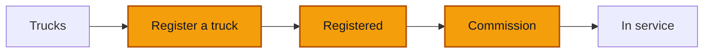

# Register a truck

**Goal** — Register a new truck, check it arrives as **Registered**, then commission it so it is **In service** and can drive.

**Log in as** — the Administrator (`boris`). The Director (`emilienne`) can do the same. Finance, the Cashier, the Technician and the Driver have no **Register a truck** button. PINs are on [Access](/start-here/01-access).

## Where you are

The workspaces are shared. Put your run code in the truck code, for example `LB14-T1`. The screenshots use `VH010`.

## Steps

### The form

1. Open **Trucks** and click **Register a truck**.

> ✅ Expected: a full page titled **Register a truck**, with the line *Copy what the papers say. Only the code, class and branch are needed now.* The address ends in `/assets/new`. The form is a column of five cards: **Identity**, **Plate and make**, **Capacity**, **Purchase** and **Papers**. Each card has a state on the right: **3 missing** on Identity, **Not started** on the others. On the right, a **So far** card and a **Still missing** card. At the bottom, a bar that stays in view with the count of missing fields, **Cancel** and **Register truck**.

2. Click **Register truck** without filling anything.

> ✅ Expected: nothing is sent. **Truck code**, **Asset class** and **Branch** turn red, each with *This field is required.* **Still missing** lists the same three fields, each with **Go**.

3. Click **Go** next to **Branch** in **Still missing**.

> ✅ Expected: the page moves to the **Branch** field and puts the cursor in it.

### Fill it in

4. In **Identity**, fill **Truck code** with your code. Pick **Truck** in **Asset class** (the other choice is **Trailer**). Pick **Douala (DLA)** in **Branch**.

> ✅ Expected: the Identity card changes to **Done**. **So far** shows the code, the class and the branch.

5. In **Plate and make**, fill **Registration number** (`LT 905 CM`), **Chassis number**, **Make** (`Mercedes-Benz`), **Model** (`Actros 2643`) and **Year** (`2022`).
6. In **Capacity**, fill **Axle count** (`3`) and **Tonnage (t)** (`26`). **Capacity**, **Capacity unit** and **Body type** can stay empty.
7. In **Purchase**, type the **Acquisition date** as dd/mm/yyyy (`15/03/2024`) or pick it with the calendar button. Fill **Acquisition amount (FCFA)** with `48500000`.
8. Leave **Papers** empty. **Supporting document (optional)** takes a photo or PDF of the carte grise, but you can add documents later from the truck.

> ✅ Expected: every card you filled reads **Done**. **So far** lists **Truck code**, **Asset class**, **Branch**, **Registration number** and **Make and model**. **Papers** still reads **Not recorded** with **Add**. **Still missing** reads **Nothing missing**, and so does the bottom bar.

9. Click **Register truck**.

> ✅ Expected: a toast **Truck registered**. You land back on the Trucks **Overview**. The **Fleet board** has a new row for your truck, and **Can drive** still counts the same, because a registered truck is not in service yet.

### The new truck

10. Click the **Trucks** tab and click your truck.

> ✅ Expected: the truck page. The title is the code and the make and model, for example **VH010 · Mercedes-Benz Actros 2643**, with a grey **Registered** badge. Under it: the plate, *Home: Douala*, *Assigned driver none*, *No odometer reading yet*, *Location: no report*. The status block says **Registered, not in service yet.** *Commission it to start its operating history.* The **To do** card says *Nothing needs you right now.*

11. Click **More actions**.

> ✅ Expected: a panel titled **All actions**, *Everything you can do on VH010, by area*, with a search box. The last group, **Lifecycle**, holds **Commission** (*From registered to in service: the operating history starts here.*).

12. Click **Commission**.

> ✅ Expected: a dialog **Commission**: *Puts the truck into service. Its operating history starts counting from here.* with **Cancel** and **Commission**.

13. Click **Commission**.

> ✅ Expected: a toast **Truck commissioned**. The badge turns green: **Available**. The header adds *In service since Oct 2026*. The status block reads **Available.** *In service since October 2026; no trips yet.* **Recent** lists **Put into service** and **Vehicle registered**, both by you.

14. Go back to **Trucks**.

> ✅ Expected: **Can drive** went up by one. Your truck is in the list with **In service**. Its row menu no longer offers **Commission**.

### On a phone

15. Open **Register a truck** at about 390 px wide.

> ✅ Expected: one card at a time, headed *Step 1 of 6 Identity*, with **Next** at the bottom (and **Back** from step 2). The last step, *Step 6 of 6 Review*, shows **So far**, **Still missing** and a **Change** button for each card.

## Try to break it

- **Reuse a code.** Register a second truck with the same **Truck code**. Expect a red banner and the same line under **Truck code**: *This asset code already exists in your workspace.* Nothing is created.

- **Double-click.** Click **Register truck** twice quickly. Expect exactly one new truck.
- **Money with decimals.** Type `48500000.50` or `48 500 000` in **Acquisition amount (FCFA)**. FCFA has no centimes; the saved amount must be a whole number, shown as *48 500 000 FCFA* on the truck's **Details** tab.
- **Bad dates.** Type `31/02/2024` or a date in the future in **Acquisition date**.
- **Leave half-way.** Fill a few fields, click **Cancel**, then come back. Nothing should have been saved.
- **Commission twice.** Open the truck in two tabs. Commission it in the first, then try in the second. The second must not create a second **Put into service** event.
- **Roles.** Sign in as `nadege`, `herve`, `clarisse` and `sali`. None of them has **Register a truck**. Type `/assets/new` in the address bar as `herve` and try to save: expect a refusal.

## Report it

Use the template in [Reporting bugs](/testing/reporting-bugs).

Next: [The truck page](/daily-work/trucks/03-truck-page)
