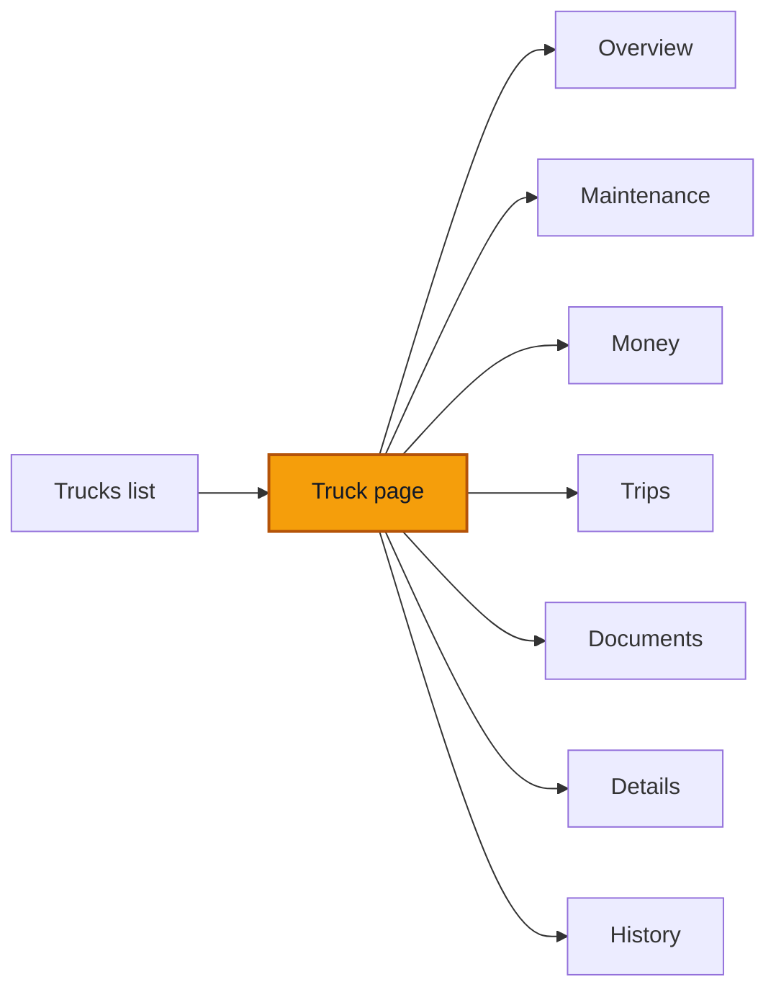

# The truck page

**Goal** — Work from one truck's page: read its header and status block, walk every tab, change its details, add and renew its papers, and move it through its lifecycle. Learn what you may edit and what ROUTIQ corrects instead.

**Log in as** — the Administrator (`boris`). The Director (`emilienne`) completes the branch transfer at the end. Then the Cashier (`clarisse`), the Technician (`herve`) and the Driver (`sali`) for the role checks. PINs are on [Access](/start-here/01-access).

## Where you are

## Who sees what

| Role | Tabs | Header buttons |
| --- | --- | --- |
| Director, Administrator | All seven | **Record expense**, **More actions** |
| Finance | All seven | **Record expense**, **More actions** |
| Technician | No **Money** | **Report a problem**, **More actions** |
| Driver | No **Money** | **Log fuel**, **Report a problem**, **More actions** |
| Cashier | No **Money**, no **Documents** | **Record expense**, **More actions** |

The demo truck VH003 (plate LT 482 AB) is set up to show everything at once: it is grounded by a brake problem, has an open bodywork problem, an expired **Visite technique** and insurance that expires soon. Dates move with the day the workspace was seeded.

## Steps

### Header and status block

1. Open **Trucks**, click the **Trucks** tab, then click **VH003**.

> ✅ Expected: the breadcrumb reads **Dashboard › Trucks › VH003**. The title **VH003** has a red **Grounded** badge. Under it, on one line: the plate **LT 482 AB**, *Home: Douala*, *Assigned driver Sali*, *Odometer 186,112 km, 2 days ago*, *Location: no report*, *In service since Mar 2019*. Top right: **Record expense** and **More actions**.

2. Read the red status block under the header.

> ✅ Expected: **Grounded for 3 days — reported: "Brake pressure warning on the Kekem descent".** *Waiting on the workshop to finish the repair (WO-0001).* Then *Also: Visite technique expired on 8 October 2026.* On the right, **Release to service** is greyed out, with a lock and *Needs WO-0001 completed first.*

The status block always says the one thing that matters most about the truck. A truck that can drive shows a green block (**Available.** *In service since September 2021; last trip 3 months ago.*). A registered truck shows **Registered, not in service yet.** A repaired truck that is still grounded shows an amber **Repair done — waiting for release to service.** See [Work orders](/daily-work/maintenance/03-work-orders).

3. Click **WO-0001** in the status block.

> ✅ Expected: the work order opens in a panel on the right. Close it with the cross or Escape.

### The tabs

4. Read the tab row.

> ✅ Expected: **Overview**, **Maintenance**, **Money**, **Trips**, **Documents**, **Details**, **History**, in that order. **Overview** carries a black count (**6**), the number of things to do. **Maintenance** carries a dot when something there needs you. The selected tab is in the address, so a reload or a shared link opens the same tab.

### Overview

5. Stay on **Overview**.

> ✅ Expected:
> - **To do** with its count: *What needs you on this vehicle, most urgent first.* Each row has one button. On VH003: **Visite technique expired** (**Renew document**), **Insurance expires in 12 days** (**Renew document**), **Problem PRB-0002 has no work order** (**Create work order**) and three **Receipt missing** rows (**Attach receipt**). A red mark means urgent, an amber one means soon.
> - At the bottom of the card, **Waiting on others** with a count and who it waits for (**Finance**). Click it to unfold.
> - On the right, the month card (**October 2026**, *This vehicle's share*): **Posted expenses**, **Awaiting review**, **Missing receipts**, and **See money**.
> - **Recent**: the last five events, and **See all history**.

6. Click the chevron at the top right of **To do**.

> ✅ Expected: the card folds to its title and count. It stays folded after a reload on this browser.

### Maintenance

7. Click **Maintenance**.

> ✅ Expected: *Problems reported on this vehicle, and the work orders that fix them.* A **Report a problem** button. **Work orders 1**: *Brake repair: replace pads and air valve, bleed the circuit*, **WO-0001** *from problem PRB-0001*, **Safety-critical**, **Approved**, *450 000 FCFA planned*. **New problems 1**: *Rear mudguard cracked and loose on its bracket*, **PRB-0002**, **Bodywork**, **Not planned yet**. Problems and work orders are covered in [Report a problem](/daily-work/maintenance/02-report-a-problem) and [Work orders](/daily-work/maintenance/03-work-orders).

### Money

8. Click **Money**.

> ✅ Expected: **Money · October 2026** with *This vehicle's share of each entry. Awaiting review is never added to posted; posted is not paid.* **Previous month** and **Next month** arrows (Next is greyed out on the current month) and **Record expense**. Four figures: **Posted expenses**, **Awaiting review**, **Missing receipts** and **Posted revenue**. Then **Expenses by category**, **Last 6 months** (a bar per month) and **Entries** with the filters **Posted**, **Expenses**, **Revenue**, **Awaiting review**, **Rejected** and **Missing receipt**. The last line gives the lifetime: *Revenue 2 850 000 FCFA · Expenses 1 345 000 FCFA · Profit 1 505 000 FCFA.*

9. Click **Previous month** until **July 2026**.

> ✅ Expected: **Money · July 2026**. Under **Entries**, **Posted 4**: *Freight revenue · Northern Trading* (+2 850 000 FCFA, *for trip DLA-2026-00001*), **Driver allowance**, **Fuel** (marked *No receipt*) and **Tolls**. The July bar in **Last 6 months** reads 1 345 000 FCFA of expenses and 2 850 000 FCFA of revenue. Entries themselves are covered in [Entries and recording](/daily-work/money/02-entries-and-recording).

### Trips

10. Click **Trips**.

> ✅ Expected: *Trips with this truck · 1,665 km recorded* and a **Record a sheet** button. Two trips: **Douala → Yaoundé** (*DLA-2026-00003*, **On the road**, started 29 July 2026) and **Douala → Garoua** (*DLA-2026-00001*, **Closed**, 14 to 15 July 2026). Each row shows the customer, the driver and the km. See [Record a sheet](/daily-work/trips/02-record-a-sheet).

### Documents

11. Click **Documents**.

> ✅ Expected: *Expiry dates drive reminders. Renewing keeps every earlier version.* and **Add a document**. Four papers: **Carte grise** (no expiry date), **Insurance** (*Expires in 12 days*), **Permit** (**Valid**, until 15 November 2027) and **Visite technique** (**Expired**, *1 earlier version kept*). Each row gives its number, its versions and *No scan on file* when no file is attached.

12. Click **Visite technique**.

> ✅ Expected: a panel: **Document**, **Visite technique**, a red **Expired** badge and *Visite technique expired on 8 October 2026.* Then **Number**, **Issued**, **Expires** and **Scan**. Under **Earlier versions**, the older number (*VT-DLA-20417*, *Valid until 10 April 2026*). A note: *Renewing creates a new version and keeps this one.* and a **Renew document** button.

Now add and renew papers on the truck you registered in [Register a truck](/daily-work/trucks/02-register-a-truck).

13. Open your truck, click **Documents**, then **Add a document**.

> ✅ Expected: a fresh truck shows *No documents yet. Add the insurance and the inspection so expiry reminders work.* The panel **Add a document** shows the truck (code, plate, branch), **Document type** (**Carte grise**, **Insurance**, **Permit**, **Visite technique**), **Title**, **Number**, **Issued**, **Expires** and **Supporting document (optional)**. **Save document** stays greyed out until a type is picked.

14. Pick **Carte grise**, fill **Number** and **Issued**, leave **Expires** empty, and click **Save document**.

> ✅ Expected: a toast **Document saved**. The carte grise is listed with *First version* and *No expiry date*.

15. Add a **Visite technique** with an **Expires** date a few days in the past.

> ✅ Expected: it is listed as **Expired**. The truck's status block adds *Also: Visite technique expired on …*, and **Overview** gets a **To do** row for it.

16. Click **⋯** on the Visite technique row, then **Renew document**.

> ✅ Expected: the renewal opens in the panel, with a back link to the document. The type is fixed, and **Number**, **Issued** and **Expires** start from the current version. Change them and click **Save renewal**.

> Known issue: when the document has no **Title**, the panel heading shows a code, *Renew VISITE_TECHNIQUE*, instead of *Visite technique*.

17. After saving, read the panel and the list.

> ✅ Expected: the panel now shows the old version with a **Replaced** badge: *This version was replaced by a renewal. It is kept unchanged.* Close it. In the list, the Visite technique shows the new number and *1 earlier version kept*. The red mark and the **To do** row are gone.

### Details

18. Click **Details**.

> ✅ Expected: three blocks.
> - **Right now**: **Availability**, **Lifecycle**, **Home branch**, **Assigned driver**, **Reported location** (*No report. Locations are reported by people, not GPS.*) and **Odometer**. These change only through their own actions, not here.
> - **Vehicle**: **Fleet code**, **Plate**, **Make and model**, **Year**, **Class**, **Chassis number**, **Acquired**.
> - **Specifications**: **Axle count**, **Body type**, **Tonnage (t)**.
>
> An empty field reads **Not recorded** with **Add**. The **Edit details** button is top right.

19. On your own truck, click **Edit details**, fill **Body type** with `Tipper` and click **Save details**.

> ✅ Expected: the fields become editable in place; **Fleet code** and **Class** stay fixed. After saving, a toast **Vehicle details saved.** and the new value is shown.

### History

20. Click **History**.

> ✅ Expected: *Everything recorded on this vehicle. Nothing is edited away: corrections appear next to the original.* Filters: **All**, **Maintenance**, **Money**, **Trips**, **Documents**, **Readings**, **Assignments**, **Lifecycle**, **Notes**. Events are grouped by day (**Today**, then dates). Each one says what happened, who did it and when, with **Open** to see the record. On your truck: **Visite technique renewed**, **Visite technique added**, **Carte grise added**, **Details edited** (*Body type: Not recorded → Tipper*), **Put into service**, **Vehicle registered**.

### Edit or correct

What you can change depends on the record, not on a button you choose.

| Record | What happens when it is wrong |
| --- | --- |
| Plate, make, model, year, chassis, purchase, specifications | **Edit details** changes them in place. History keeps the old and new value. |
| Documents | Never edited. **Renew document** adds a new version and keeps the old one. |
| Odometer readings | Never edited. *A reading stays as it was captured; a correction adds a new row.* |
| Notes | Never edited. *A correction is another note.* |
| Posted money | Never edited. **Cancel entry**, then **Record again**. See [Approve and reject](/daily-work/money/03-approve-and-reject). |
| Truck code, class | Fixed after registration. |

### More actions

21. Click **More actions**.

> ✅ Expected: the **All actions** panel, *Everything you can do on VH003, by area*, with a search box (*Search, e.g. fuel, renew, sign off*). Groups: **Capture** (**Log fuel**, **Record expense**, **Attach receipt**, **Record odometer**, **Add note**), **Maintenance** (**Report a problem**, **Create work order**, **Authorize work order**, **Complete work**, **Sign off the work**, **Cancel work order**, **Release to service**), **Operations** (**Record a sheet**, **Change assigned driver**, **Transfer home branch**), **Documents** (**Add a document**, **Renew document**) and **Money** (**Record revenue**). An action you cannot take right now is greyed out with a lock and says why, for example *Nothing waiting for authorization.*

22. Type `renew` in the search box.

> ✅ Expected: only **Renew document** stays (*Records the new version of a document. The old one is kept.*).

### Lifecycle

A truck goes **Registered** → **In service**. **Commission** does that step; see [Register a truck](/daily-work/trucks/02-register-a-truck). Grounding is not a lifecycle step: a grounded truck is still in service, it just cannot drive.

23. On your truck, open **More actions** → **Transfer home branch**. Pick **Yaoundé (YDE)** in **Assign to branch** and click **Transfer home branch**.

> ✅ Expected: the dialog explains *Moves the truck to another branch. Records already booked stay with the branch that made them.* As the Administrator, the dialog then shows **Approval required**: *A transfer to another branch needs an approval. That step arrives with the approval flow.* Close it. The truck stays in Douala. No request appears in any list; the Director has to make the move.

24. Sign in as `emilienne` (Director) and do the same transfer.

> ✅ Expected: a toast **Truck assigned**. The header now reads *Home: Yaoundé*. In **History**, the **Assignments** filter shows *Moved to branch YDE* by Émilienne.

Selling, retiring or writing off a truck is not in the app yet. Look for it in the row menu and in **More actions**; you should find nothing.

### Other roles

25. Sign in as `clarisse` (Cashier) and open VH003.

> ✅ Expected: the header shows **Douala** in the branch picker. Tabs: **Overview**, **Maintenance**, **Trips**, **Details**, **History**. No money card on **Overview**. The status block has no **Release to service** button.

26. Sign in as `herve` (Technician), then `sali` (Driver), and open VH003.

> ✅ Expected: no **Money** tab. Hervé has **Report a problem** in the header and **Complete work** in the status block. Sali has **Log fuel** and **Report a problem**, and her status block adds *Do not drive it until a manager releases it to service.*

### On a phone

27. Open VH003 at about 390 px wide.

> ✅ Expected: the header wraps over several lines, the status block keeps its button, and the tabs scroll sideways. A floating bar offers **Expense**, **Problem**, **Trip** and **More** above the bottom bar.

## Try to break it

- **Two tabs.** Open your truck in two browser tabs. Edit details in one, then save different details in the other. The second save must not silently overwrite the first.
- **Renew twice.** Renew a document, then try to renew the replaced version from its panel. Only the current version should offer **Renew document**.
- **Expiry before issue.** Add a document whose **Expires** is before **Issued**.
- **No expiry.** A document with no expiry date must never show as valid by mistake. The **All actions** panel says *A missing expiry date shows as unknown, never as valid.*
- **History is complete.** After every change on this page, open **History**. Each change must be there, with your name. Nothing may disappear.
- **Wording.** Every screen should say *truck* on Transports Ngwa. Note any *asset* or *vehicle* you see in a title, button or toast.
- **Roles by address.** As `clarisse`, type the address of VH003's `/documents` tab. She must not see documents.

## Report it

Use the template in [Reporting bugs](/testing/reporting-bugs).

Next: [Trips — Overview](/daily-work/trips/01-overview)
