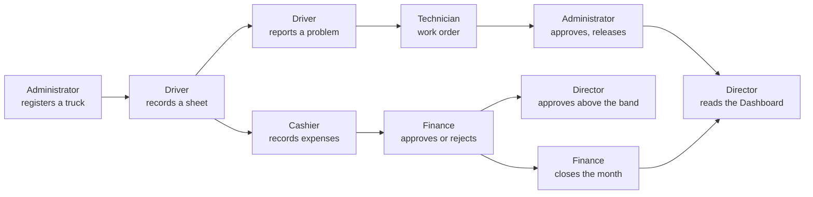

# Company flow

**Goal** — See how one week of work moves through Transports Ngwa, person to person, and where each step lands on the Director's Dashboard.

**Log in as** — the person each step names. Sign out at every handoff. Usernames are below; PINs are on [Access](./01-access.md).

## Where work goes

## The story

Each step names the lesson that shows the screens in detail.

1. **Director (`emilienne`) — start of the week.** Open the **Dashboard**. Read the summary, the tiles and **To do**. Note the numbers: you will see them move. → [Dashboard](/daily-work/dashboard)
2. **Administrator (`boris`) — a new truck.** Register a truck in Douala and put it in service. → [Register a truck](/daily-work/trucks/02-register-a-truck), [The truck page](/daily-work/trucks/03-truck-page)
3. **Driver (`sali`) — a trip.** Record the paper trip sheet for that truck: route, km, fuel and other expenses. → [Record a sheet](/daily-work/trips/02-record-a-sheet), [Expenses and revenue](/daily-work/trips/03-expenses-and-revenue)
4. **Driver (`sali`) — a problem on the road.** Report a problem on the truck. Mark it safety-critical if the truck must not drive. → [Report a problem](/daily-work/maintenance/02-report-a-problem)
5. **Technician (`herve`) — the repair.** Open a work order from the problem, add the cost, complete the work. → [Work orders](/daily-work/maintenance/03-work-orders)
6. **Administrator (`boris`) — back on the road.** Approve the work order and release the truck to service. → [Work orders](/daily-work/maintenance/03-work-orders)
7. **Cashier (`clarisse`) — the counter.** Record a few expenses with receipts: one small (posts at once), one above 100 000 FCFA (waits for review). → [Entries and recording](/daily-work/money/02-entries-and-recording)
8. **Finance (`nadege`) — decisions.** Open **Money → To approve**. Approve one entry, reject one with a reason. → [Approve and reject](/daily-work/money/03-approve-and-reject)
9. **Director (`emilienne`) — the large one.** Approve the entry above 1 000 000 FCFA that only the Director may decide. → [Approve and reject](/daily-work/money/03-approve-and-reject)
10. **Finance (`nadege`) — close the month.** Lock the last month once nothing waits. → [Accounting months](/daily-work/money/04-accounting-months)
11. **Director (`emilienne`) — end of the week.** Open the **Dashboard** again. → [Dashboard](/daily-work/dashboard)

> ✅ Expected at step 11: the new truck counts in **Trucks that can drive**. The approved expenses moved **Expenses** and **Profit**, and appear in **What changed the profit**. The rejected entry counts nowhere. **To do** no longer lists what you decided. **Profit by truck** shows the new truck with its own revenue, expenses and profit.

## Rules the story checks

- **Nobody decides their own entry.** Not even the Director (whose own entries post directly instead).
- **Bands decide who approves.** Up to 100 000 FCFA posts directly. Up to 1 000 000 FCFA, Finance decides. Above that, the Director. An Administrator can move these bands in [Company settings](/company/company-settings).
- **Grounded means grounded.** A safety-critical problem grounds the truck at once. Finishing the work does not free it; only **release to service** does.
- **Warn, don't block.** A trip can close with things missing. It closes with gaps listed, and its profit is marked as not to be trusted until someone fills them.
- **Records are corrected, not edited.** A posted entry is cancelled with a reason and recorded again. The original stays visible.

## Try to break it

- **Skip a handoff.** Do step 8 as `clarisse`. Expect no **To approve** tab and no way to approve.
- **Release too early.** As `herve`, look for a way to release the truck to service. Expect none: only the Administrator or Director may.
- **Wrong branch.** As `amadou` (Yaoundé), look for the truck from step 2. Expect nothing.

## Report it

Use the template in [Reporting bugs](/testing/reporting-bugs). Say which step of the story you were on.

Next: [What's new in October 2026](/release-2026-10/)
