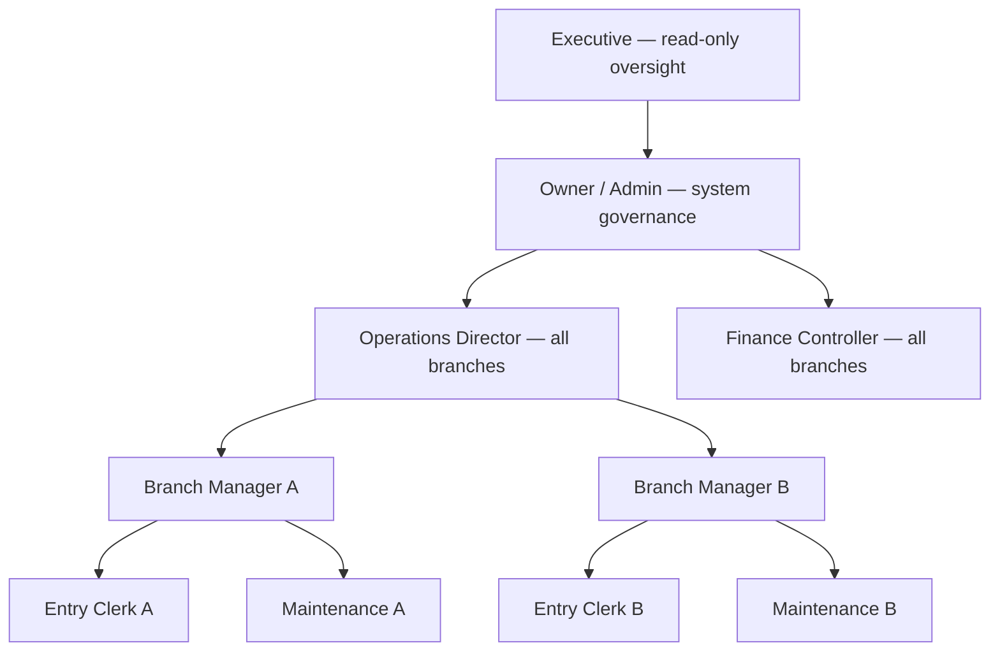

# How the test company operates

The test accounts form one operating company, not ten unrelated personas. Work begins at headquarters, moves through a branch, crosses a finance checkpoint when necessary, and ends in read-only executive review.

## Reporting structure

These arrows explain business responsibility. They do not grant permissions. ROUTIQ derives authorization from each account's fixed role and server-side branch scope.

## The operating loop

```mermaid
flowchart LR
  A["Admin verifies company setup"] --> B["Branch Manager prepares asset"]
  B --> C["Entry Clerk records daily work"]
  C --> D["Maintenance reviews asset usage"]
  D --> E["Branch Manager handles exception"]
  E --> F["Finance decides submitted money"]
  F --> G["Operations moves asset between branches"]
  G --> H["Second branch continues work"]
  H --> I["Finance locks period"]
  I --> J["Executive reviews results"]
```

### 1. Admin establishes control

Sign in as Owner / Admin. Under **More → Branches**, confirm the two operating branches. Under **More → Users**, confirm that headquarters accounts have all branches and local teams have exactly one.

The Admin owns access and configuration, not daily data entry. After setup, sign out and continue as a Branch Manager.

### 2. Branch Manager prepares operations

The first Branch Manager registers an asset, commissions it, and registers any driver or crew record the branch needs. Use [Register an asset](/walkthroughs/assets/01-register-asset) and [Lifecycle](/walkthroughs/assets/03-lifecycle).

The resulting asset remains in the manager's branch and is ready for the clerk.

### 3. Entry Clerk captures the day

The local Entry Clerk creates a trip, records its legs and crew, and adds revenue and expenses. Continue through [Create a trip](/walkthroughs/activities/01-create-trip) and [Record costs](/walkthroughs/activities/02-record-costs).

Amounts at or below the workspace threshold post immediately. Larger amounts are safely saved as **Pending** and handed to Finance.

### 4. Maintenance reviews asset usage

Sign in as Maintenance for the same branch. Open the active trip and inspect its asset and readings. Confirm that assets from the other branch are absent and that general operating and finance actions are unavailable.

The server permits this role to record meter readings, but the current web app does not expose **Record reading** to it. Treat that as a known web gap, not a successful maintenance handoff. Return to the Entry Clerk to record the reading and close the trip until the UI control is separated.

If a closed trip needs correction, the Branch Manager—not the clerk—uses **Reopen** with a reason. See [Close a trip](/walkthroughs/activities/03-close-trip).

### 5. Finance applies four-eyes control

The Finance Controller opens **Finance → Approvals** and decides entries submitted by the branch teams. They can approve, reject with a reason, reverse posted entries, and lock a month. They cannot approve an entry they created themselves.

Run [Approve and reject](/walkthroughs/approvals/01-approve-and-reject) with work from both branches so the all-branch queue has meaning.

### 6. Operations coordinates a branch handoff

The Operations Director can see both branches. They initiate an assignment of the asset to the second branch; because it crosses branches, the attempt requires Finance's approval role. Finance completes the transfer.

Afterward, the first branch team must lose the asset from its scope and the second Branch Manager must gain it. Historical trips remain booked to the branch that created them. The [branch walkthrough](/walkthroughs/branches) tests this boundary explicitly.

### 7. Executive reviews without editing

Sign in as Executive after the operational and finance work is complete. Review company-wide dashboard totals, the asset's new branch, and the recorded trip. Confirm that there is no **New**, **Record**, **Assign**, **Approve**, **Reverse**, or administrative action.

## What must never happen

- A local account sees records belonging only to the other branch.
- Selecting a branch in the header grants access the account did not already have.
- A maker approves their own financial entry.
- A cross-branch transfer silently moves historical trips or financial records.
- Executive gains any write path, or Maintenance gains a write path beyond its intended meter-reading command.
- Admin becomes the default actor for a step another job should own.

Next: [Run the company test flow](/testing/how-to-test)
