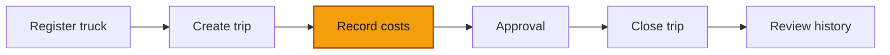

# 02 — Record costs

**Goal** — Charge money to the open trip two different ways, and watch the approval threshold decide whether an entry posts immediately or goes to an approver.

**Log in as** — the same **Entry Clerk** who created the trip. The threshold behavior in this lesson shows how branch capture hands high-value entries to Finance.

**Handoff** — small entries finish immediately; leave the large entries Pending for the Finance Controller walkthrough.

## Where you are

## The rule you are testing

The pilot approval threshold is **100 000 XAF** per entry. At or below it, an entry posts on the spot. Above it, the Entry Clerk's entry is saved as **Pending** and waits for a decision. That is a success, not a failure — the record is safe, it is just not final. Amounts are whole XAF: **1 XAF is the smallest unit, there are no centimes.**

## Steps

### A small expense, charged from the trip

1. Open **Trips** and click into the trip you created in lesson 01. Confirm the chip still reads **Open**.
2. Click **Record expense** in the header.

> ✅ Expected: a dialog titled **Expense on this trip** with the note *The expense is attributed to this trip and to the chosen truck.*

*Trip expenses are attributed to both the trip and the selected asset.*

3. Choose a **Category** (fuel, tolls, and so on), type `45000` in **Amount**, leave **Economic date** on today, choose a **Payment method**, pick the **Asset**, and fill **Counterparty (optional)** with the station's name.
4. Click **Record the expense**.

> ✅ Expected: a toast **Expense recorded**. The dialog closes and the trip's **Revenue and costs** panel now lists the line, with the net figure updated.

*The 45,000 expense posts immediately and changes the posted net.*

### A large expense, from the same dialog

5. Click **Record expense** again. Same fields, but type `250000` in **Amount**. Submit.

> ✅ Expected: a toast **Expense sent for approval** — a different message from step 4. On the trip page, the line appears under **Awaiting approval**, with the hint *Lines awaiting approval are listed but stay out of the net.* The net figure does **not** move.

*The 250,000 expense is listed as Pending and excluded from the posted net.*

### Revenue, from the Finance section

6. Click **Finance** in the navigation. You land on **Entries**. Click **Record an entry**.

> ✅ Expected: the page header reads **Record a transaction**, with an **Expense** / **Revenue** choice at the top and **Expense** selected. (Recording is a button on **Entries**, not a tab in the finance sub-navigation — as the Entry Clerk, **Entries** is the only finance tab you have.)

*The standalone finance form starts on Expense and exposes the complete posting context.*

7. Switch to **Revenue**.

> ✅ Expected: the **Category** list reloads — revenue categories and expense categories are separate lists, and a category from the wrong side cannot be used.

*Switching direction reloads the form with revenue-specific categories.*

8. Fill **Branch**, **Category**, **Amount (XAF)** with `90000`, **Payment method**, **Date**, **Counterparty (optional)**, **Description (optional)**, **Payment reference (optional)**, and pick the truck under **Asset (optional)**. Optionally attach a receipt under **Supporting document (optional)**.
9. Click **Record**.

> ✅ Expected: a toast **Transaction recorded and posted**, and you land on **Entries** with the new row at the top carrying a **Posted** status chip.

*The 90,000 revenue appears in Entries with Posted status.*

10. Record one more revenue line of `300000` the same way.

> ✅ Expected: a toast **Transaction sent for approval** instead, and the row on **Entries** carries a **Pending** chip.

*The 300,000 revenue remains Pending until an approver decides it.*

11. Open one of the pending rows.

*Opening the row moves from the ledger view into the individual entry record.*

> ✅ Expected: the entry detail page shows **Entry number**, **Direction**, **Status**, **Category**, **Amount**, **Economic date**, **Posting date**, **Counterparty**, **Payment method**, and its **Posting lines**. There is no **Reverse** action — an entry has to be posted before it can be reversed, and this role could not reverse it anyway.

*The Pending record exposes its business details and posting lines without a Reverse action.*

## Try to break it

- **Type centimes.** Put `45000.50` (or `45 000,50`) in **Amount (XAF)** and try to submit. Expect **Please enter a number.** and a disabled submit. Any decimal point or comma is rejected outright: XAF has no sub-unit.
- **Record zero.** Put `0` in the amount. Expect the same refusal — an entry must be strictly positive.
- **Use a category from the wrong side.** On the **Record** screen note which categories appear under **Expense** and under **Revenue**. They must never overlap; if one list offers a category belonging to the other kind, that is a bug worth reporting (the server answers *The selected category does not match the entry type (revenue / expense).*).
- **Skip the receipt on a category that expects one.** Record an expense in a receipt-expected category with no **Payment reference** and no attachment. Expect the entry to **post anyway**, with a warning line in the same toast: *Missing evidence: this category requires supporting documentation or a photo.* ROUTIQ warns, it does not block — the one hard boundary is a locked period.
- **Post into a locked period.** Have the Finance Controller lock last month under **Finance → Periods**, then record an entry with a **Date** inside it. Expect a refusal: *This period is locked. No postings are possible.*
- **Compare roles on the same amount.** Sign in as **Admin** and record an expense of `250000`. Expect **Transaction recorded and posted** — not pending. Above the threshold the seeded rules authorise `ADMIN` and `FINANCE_APPROVER` directly, so only the Entry Clerk's large entries queue up.

> ⚠️ Note for maintainers: two wording issues on these screens.
>
> 1. `docs/business-rules.md` §3 reads as though *any* entry over the threshold is held for a decision. In the code the most-specific matching rule wins, and above 100 000 XAF only the open-ended `FINANCE_APPROVER` / `ADMIN` rules match — so those two roles auto-post any amount. Worth restating the rule as "over the threshold, an entry needs an approver role — either yours or someone else's".
> 2. The **Asset** label inside the trip's expense dialog and the **Assign to a vehicle…** placeholder on the finance form are not covered by the trucking overlay, so they say *asset* / *vehicle* on a screen otherwise talking about trucks.

Next: [03 — Close a trip](/walkthroughs/activities/03-close-trip)
