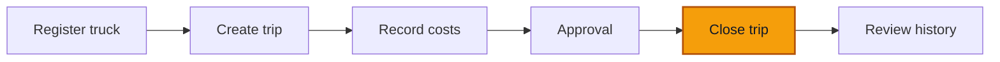

# 03 — Close a trip

**Goal** — Close the trip, read the completeness verdict it produces, and confirm that missing data is flagged rather than blocked.

**Log in as** — **Entry operator** for the close. You will need **Admin** for the reopen at the end.

## Where you are

## The rule you are testing

Closing a trip **warns, it does not block**. Only two things stop a close outright: no actual dates, and no truck assigned. Everything else that is missing becomes a stable code stored on the trip and shown as an exception. A system that refuses the close only makes the clerk invent a number.

On the trucking preset a closed trip is expected to carry legs, crew, revenue, a departure reading and an arrival reading.

## Steps

1. Open **Trips** and click into the trip from lessons 01 and 02. Confirm the chip reads **Open**.
2. Click **Close** in the header.

> ✅ Expected: a dialog titled **Close the trip** with the note *Anything missing is flagged on the record, never invented.*, a field **End date and time (optional)** and a **Note (optional)** box, plus **Cancel** and **Confirm closing**. The end date is optional here because your sheet already recorded an **Arrival**.

*Closing accepts an optional end time and note before calculating completeness.*

3. Leave the end date alone, type a short note, and click **Confirm closing**.

> ✅ Expected: a toast **Trip closed**, and the trip's status chip changes from **Open** to **Closed**.

4. Read the banner that appears above the trip's panels.

> ✅ Expected: because lessons 01 and 02 never attributed **revenue** to this trip, the banner reads **Closed with exceptions** with the line *The trip is closed, but the following are missing:* and the item **No revenue attributed**. (Revenue only counts towards a trip when it is entered on the sheet with **Charge to this trip** ticked — a revenue line recorded from **Finance → Record** is attached to the truck, not to the trip.)

*The trip closes successfully while preserving the missing-revenue exception.*

> ✅ If you did attribute revenue on the sheet, the banner reads **Complete** with the hint *Every expected detail was recorded.* instead.

5. Look at the header actions now.

> ✅ Expected: **Close**, **Add leg**, **Record reading** and **Record expense** have all disappeared — a closed trip takes no more capture. As the Entry operator you should see **no** action buttons at all except **History**.

6. Sign out and sign in as **Admin**. Open the same trip.

> ✅ Expected: a **Reopen** button is now in the header. Reopening is a manager's call, not a clerk's.

*An administrator sees Reopen where the Entry operator saw only History.*

7. Click **Reopen**.

> ✅ Expected: a dialog titled **Reopen the trip** with the note *Reopening clears the completeness verdict. The reason stays in the audit trail.*, a required **Reason** field placeholdered *Why reopen this trip?*, and **Confirm reopening**.

*The reopen command requires a reason that remains in the audit trail.*

8. Type a reason and confirm.

> ✅ Expected: a toast **Trip reopened**, the chip returns to **Open**, and the completeness banner disappears — the verdict is cleared, not kept stale.

*The reopened trip returns to Open state and no longer carries a completeness verdict.*

9. Open **History** on the trip.

> ✅ Expected: **Trip sheet recorded**, **Activity closed** and **Activity reopened** all listed in order, each with its author and the reopen reason preserved.

*Trip history preserves the full close-and-reopen sequence and its actors.*

10. Close the trip again so it is left tidy for the next tester.

*The walkthrough fixture is left closed and ready for the next tester.*

## Try to break it

- **Force a hard block.** From **Trips**, use **Record a sheet** to start a trip and — if your workspace lets you get that far — try to close a trip with no **Arrival** recorded. Expect *Cannot close: the actual dates or at least one assigned asset are missing.* These are the only two hard stops.
- **Close a trip with no crew and no legs.** Record a sheet with the crew row and both leg rows left blank, then close it. Expect the close to **succeed** with **Closed with exceptions** listing **No crew recorded** and **No legs recorded** — never a refusal.
- **Close without meter readings.** Record a sheet without clicking **Add meter readings**, then close it. Expect exceptions **Start meter reading missing** and **End meter reading missing**.
- **Reopen as the Entry operator.** Sign in as the Entry operator and open a closed trip. Expect **no Reopen button** at all.
- **Record a reading that goes backwards.** On an open trip click **Record reading** and enter an odometer value lower than one already captured. Expect the reading to be **accepted**, with the warning *The reading is lower than the previous one* riding along in the same toast. Then check the trip's **Meter readings** panel — the earlier reading is still there. A correction adds a row; it never overwrites one.
- **Close a trip twice.** Open the same closed trip in two tabs and confirm the close in both. Expect the second attempt to fail rather than double-stamp the record.

Next: [Approve and reject](/walkthroughs/approvals/01-approve-and-reject)
