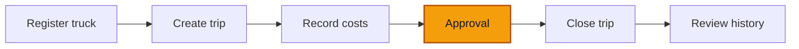

# 01 — Approve and reject

**Goal** — Work the approval queue: approve one entry, reject another with a reason, and prove that nobody can approve their own submission.

**Log in as** — **Finance approver**. You will switch to the **Entry operator** and back to test the maker guard.

## Where you are

## Before you start

You need at least two entries sitting at **Pending**. Lesson 02 of the activities track produces them: as the **Entry operator**, record an expense of `250000` and a revenue of `300000`. Anything above **100 000 XAF** from that role lands in the queue.

## Steps

1. Click **Finance** in the navigation.

> ✅ Expected: as the Finance approver you now see three tabs — **Entries**, **Approvals** and **Periods**. **Approvals** carries a count badge of everything pending in your branch scope.

2. Click **Approvals**.

> ✅ Expected: the page header reads **Approvals** and the queue is sorted **oldest first** — the honest order for a queue. Each row shows **Entry number**, **Status** (a **Pending** chip), the date, a **Branch** chip, **Category**, **Amount** and **Counterparty**.

3. If the queue looks shorter than expected, check the line under the toolbar.

> ✅ Expected: when the shell is narrowed to one branch you get *Filtered: `branch name` — N results*, and if work is waiting elsewhere, a clickable link *+N pending in other branches* that widens the queue back to all of them. A filtered queue is never silently presented as the whole queue.

4. Open the `⋯` menu on the row you want to approve, and choose **Approve**.

> ✅ Expected: a dialog titled **Approve entry** with an optional field labelled **Note (optional)** and a placeholder *Add a note…*. The confirm button reads **Approve**.

5. Type a short note and click **Approve**.

> ✅ Expected: a toast **Entry approved**. The row leaves the queue, and the **Approvals** badge drops by one. The row is gone because the server says the entry is decided, not because the screen crossed it off locally.

6. Open the `⋯` menu on a second row and choose **Reject**.

> ✅ Expected: a dialog titled **Reject entry** with a field labelled **Rejection reason**, placeholder *Explain why this entry is being rejected…*, and a **Reject** button that is **disabled** while the box is empty.

7. Type a reason and click **Reject**.

> ✅ Expected: a toast **Entry rejected**, and the row leaves the queue.

8. Go to **Entries** and find both decided entries.

> ✅ Expected: the approved one carries a **Posted** chip; the rejected one carries a **Rejected** chip. Open the rejected entry — the detail page shows a **Rejection reason** field holding exactly what you typed.

9. Still as the Finance approver, open a **Posted** entry from **Entries** and use the `⋯` menu's **Reverse** (or the **Reverse** action on the entry's own page).

> ✅ Expected: a dialog titled **Reverse entry** with a required **Reason for reversal** box. After submitting you get **Entry reversed**, the original entry now carries a **Reversed** chip, and both entries show a **Reversal chain** section: the original says **Reversed by entry**, the new one says **Reverses entry**. The original figures are still on screen — a correction is a mirror entry with the negated amount, never an edit.

## Try to break it

- **Approve your own work.** Sign in as the **Finance approver**, record an entry above 100 000 XAF yourself, then open **Approvals**. Expect your own row to be listed but to carry an orange chip **Your submission — another approver must decide**, and its `⋯` menu to offer **no** Approve or Reject. Maker never equals approver, even for an admin. The server enforces it too: if you find a way to send the command anyway, it answers *You cannot approve an entry you created yourself.*
- **Reach the queue as the Entry operator.** Sign in as the Entry operator and browse to `/finance/approvals` directly. Expect a permission-denied page and no **Approvals** tab in the finance sub-navigation.
- **Reject with only spaces.** Type a few spaces into **Rejection reason**. Expect **Reject** to stay disabled — the reason is trimmed before it counts.
- **Decide the same entry twice.** Open the queue in two tabs, approve a row in tab A, then approve the same row in tab B. Expect tab B to refresh itself rather than double-decide, or to fail with *This action is not possible in the record's current state.*
- **Reverse twice.** Reverse a posted entry, then try to reverse the same original again. Expect *This entry has already been reversed.* An entry reverses at most once.
- **Reverse a pending entry.** Find an entry still at **Pending** and look for **Reverse**. Expect it to be absent — only a posted entry can be reversed.
- **Lock a period that still has pending entries.** Go to **Periods**, and lock a month that still holds a **Pending** entry. Expect the lock to **succeed** with a warning *This period contains entries awaiting approval.* — a warning, not a refusal.

> ⚠️ Note for maintainers: the queue's third column is headed **Economic date** but renders `submittedAt` — the date the entry entered the queue, not its economic date (`apps/web/src/screens/FinanceApprovalsScreen.tsx`, the `submittedAt` column reuses `finance.entries.detail.date`). Approvers comparing the queue against **Entries** will see two different dates under the same label.

Next: [Passenger overlay](/walkthroughs/passenger-overlay)
