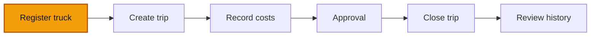

# 01 — Register a truck

**Goal** — Put a new truck into the register and confirm it lands with the status `Registered`.

**Log in as** — **Admin**. Registering a truck is an admin/ops action; the Entry operator account can see the button but the server refuses the command (you will test that at the end of this lesson).

## Where you are

## Steps

1. In the left navigation (bottom bar on a phone), click **Trucks**.

*An empty trucking workspace leads directly into the first registration.*

> ✅ Expected: the page header reads **Your trucks**, under the eyebrow **OPERATIONAL FLEET**. If the workspace is empty you get the first-run panel **Register your first truck** with a **Register a truck** button; otherwise you get the truck table plus a **New truck** button in the header.

2. Click **New truck** (or **Register a truck** on the empty state).

*The registration form separates identity, acquisition, capacity, and preset fields.*

> ✅ Expected: you land on the form page titled **Register a truck**, with the small heading **NEW REGISTRATION** above it. The URL ends in `/assets/new`.

3. Fill in **Truck code** with something unique and readable, e.g. `TRK-001`.
4. Choose an **Asset class** from the dropdown, and choose the **Branch** the truck belongs to.

> ⚠️ If the branch switcher at the top of the shell is set to a specific branch, **Branch** is pre-filled with it. Changing it here is allowed.

5. Fill in the identity fields the sheet gives you: **Registration number** (the plate), **Year**, **Make**, **Model**, **Chassis number**.
6. Fill in **Acquisition date** and **Acquisition amount (XAF)**.

> ✅ Expected: as soon as **Acquisition amount (XAF)** holds a number, a grey helper line appears under the field showing it grouped as money, e.g. `18 500 000 XAF`. No decimal part is ever shown — XAF has no centimes.

7. Optionally set **Capacity** and **Capacity unit**.
8. In the **Template fields** box, fill **Axle count**, **Body type** and **Tonnage (t)** if you know them. Leave them blank if you don't.

> ✅ Expected: none of the three carries a `*`. On the trucking preset every template field is optional.

9. Optionally drag a photo or a PDF of the carte grise into **Supporting document (optional)**.
10. Click **Register truck**.

*A completed registration includes the truck identity, branch, acquisition, and optional trucking fields.*

> ✅ Expected: a green toast **Truck registered**, and you are sent back to **Your trucks**. The new truck appears as a row showing its code, plate, class, branch, and a grey **Registered** status chip.

*The new truck appears in the fleet table with its branch and Registered chip.*

11. Click the new row to open the truck.

> ✅ Expected: the record page shows the truck's name, its code and plate in mono type underneath, the **Registered** chip, its class and branch. A **Profitability** card says **Nothing posted against this truck yet.** A **Recent trips** card says **No trips for this truck.** In the header you have **Commission**, **Assign** and **History**.

*The truck record begins in Registered state with Commission, Assign, and History actions.*

## Try to break it

- **Submit with nothing filled in.** Click **Register truck** on an empty form. Expect inline **This field is required.** under **Truck code**, **Asset class** and **Branch**, and no toast — the request is never sent.
- **Reuse a truck code.** Register a second truck with the same **Truck code** as the first. Expect a red banner and an inline error on **Truck code**: *This asset code already exists in your workspace.* The first truck is untouched.
- **Type centimes into the money field.** Put `18500000.50` into **Acquisition amount (XAF)**. Expect the form to refuse it — amounts in ROUTIQ are whole XAF, there is no sub-unit to divide by 100.
- **Double-click Register truck.** Click the submit button twice in quick succession. Expect exactly **one** truck in the list. A repeat of an unchanged form replays the same command envelope, so the retry lands on the original result instead of creating a twin.
- **Try it as the Entry operator.** Sign out, sign in as the Entry operator, go to **Trucks** and press **New truck**, fill the form and submit. Expect the command to fail with *Your role does not allow this action.*

> ⚠️ Note for maintainers: the **New truck** button, the empty-state action and the floating add button are all shown to the Entry operator (`FIELD_SUBMITTER`), but `register-asset` only allows `ADMIN` and `OPS_MANAGER` — so the role discovers the refusal after filling the whole form. `apps/web/src/assets/permissions.ts` gates on "not a read-only role" while `apps/api/src/commands/register-asset.ts` gates on the two manager roles. `start-here/02-accounts.md` also lists "Register and commission trucks" under what the Entry operator *can* do, which the server contradicts.

Next: [02 — Edit and correct](/walkthroughs/assets/02-edit-and-correct)
