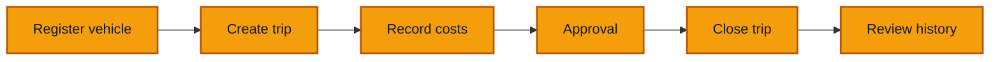

# 08 — Passenger overlay

**Goal** — Run the same core loop in the passenger-transport workspace and confirm that the preset changes the **words** (and one required field), never the behaviour.

**Log in as** — the corresponding Passenger Test jobs: Yaoundé Branch Manager, Yaoundé Entry Clerk, Maintenance, Finance Controller, and Executive. Use workspace slug `passenger-test` and the [public credential table](/start-here/01-access).

**Handoff** — repeat the same company workflow under passenger vocabulary; job ownership and permissions must not change with the preset.

## Where you are

The whole loop again, faster:

## What the preset changes

A workspace enables one or more **template presets**. The preset supplies a sparse overlay of wording on top of the base English (and French) strings — it renames concepts, it never adds screens or rules. Here is what actually differs, checked against `apps/web/src/i18n/presets/`.

| Where | `TRUCKING` | `PASSENGER_TRANSPORT` |
|---|---|---|
| Navigation | Trucks | Vehicles |
| Assets page | Your trucks | Your vehicles |
| Assets button | New truck | New vehicle |
| Empty-state action | Register a truck | Register a vehicle |
| Registration form | Register a truck | Register a vehicle |
| Identity field | Truck code | Vehicle code |
| Submit button | Register truck | Register vehicle |
| Success toasts | Truck registered / commissioned / assigned | Vehicle registered / commissioned / assigned |
| Asset record breadcrumb | Truck record | Vehicle record |
| Documents page | Truck documents | Vehicle documents |
| Home tile | Trucks in service | Vehicles in service |
| Finance asset field | Truck (optional) | Vehicle (optional) |
| Trip list column | Primary truck | Primary vehicle |
| Sheet flavour | Haulage job — **Cargo**, **Weight (kg)**, per-leg **Load** | Journey — **Seats sold**, **Seats available**, per-leg **Passengers** |
| Required template field | none | **Seat count \*** |

**In English, "Trips" does not change.** Both presets call the activity a trip. The distinction only exists in French: trucking says **Trajets**, passenger transport says **Voyages** (and both call a leg an **Étape**). To see it, switch the app to Français under **More → Language**.

## Steps

Each step is a lesson you have already done. Do it quickly, and watch the labels rather than the mechanics.

*The passenger preset changes the fleet label to Vehicles while English activity navigation remains Trips.*

1. **Repeat [assets lesson 01](/walkthroughs/assets/01-register-asset)** as the **Yaoundé Branch Manager**, registering a bus.

*The passenger fleet begins with the same first-run pattern under passenger wording.*

> ✅ Expected: identical flow, with **Vehicles**, **New vehicle**, **Register a vehicle**, **Vehicle code**, **Register vehicle**, toast **Vehicle registered**. The **Template fields** box now holds **Seat count** and **Line type** instead of the three trucking fields — and **Seat count** carries a `*`.

*The passenger form renames the asset identity and introduces its required Seat count field.*

*BUS-001 is ready to register with passenger-specific template values.*

*The registered bus appears under Your vehicles with the same fleet-table structure.*

2. **Repeat [assets lesson 03](/walkthroughs/assets/03-lifecycle)**: commission the bus, then assign it.

> ✅ Expected: same two actions, same dialogs, same six statuses. Toasts read **Vehicle commissioned** and **Vehicle assigned**. A cross-branch assignment still needs the Finance Controller.

*Commissioning changes BUS-001 to In service without changing the lifecycle mechanics.*

*Assignment uses the same command and updates the vehicle's current branch.*

3. **Repeat [activities lesson 01](/walkthroughs/activities/01-create-trip)** as the **Entry Clerk**.

> ✅ Expected: the sheet is the **Journey** flavour. The flavour card is **Seats** with **Seats sold** and **Seats available**; the money card opens with one revenue line already there (a passenger run always took money, so there is nothing to add first). Each leg offers **Passengers** where the haulage sheet offered **Load**. Everything else — References, Vehicle and meters, Crew, Legs — is the same form.

*The Journey flavour exposes passenger counts, seats, and an initial revenue line.*

*The completed journey records BUS-001, Marie Tester, passenger counts, readings, and ticket revenue.*

*The passenger trip record uses the same panels while retaining journey-specific data.*

4. **Repeat [activities lesson 02](/walkthroughs/activities/02-record-costs)**: one expense under 100 000 XAF and one over.

> ✅ Expected: exactly the same two outcomes, **Expense recorded** and **Expense sent for approval**. The threshold is workspace data, so check what this workspace's threshold actually is before concluding anything.

*Passenger trip costs use the shared expense dialog and approval threshold.*

*Posted costs affect the net while pending costs remain visibly excluded.*

5. **Repeat [activities lesson 03](/walkthroughs/activities/03-close-trip)**: close the trip.

> ✅ Expected: the same verdict machinery — **Complete** or **Closed with exceptions** — with the same five expectations (legs, crew, revenue, departure reading, arrival reading). The passenger preset sets exactly the same completeness requirements as trucking.

*The passenger trip uses the same close confirmation and optional note.*

*With legs, crew, revenue, and both readings present, the closed journey is Complete.*

6. **Repeat [the approvals lesson](/walkthroughs/approvals/01-approve-and-reject)** as the **Finance Controller**.

> ✅ Expected: byte-for-byte the same queue. Nothing in the finance module is overlaid by either preset — the words **Approvals**, **Approve**, **Reject**, **Posted**, **Pending**, **Reversed** are shared.

*The passenger queue is structurally and verbally identical to the trucking queue.*

*Approving a passenger-workspace entry uses the shared finance decision dialog.*

*Rejecting likewise requires the shared rejection reason.*

*After one approval and one rejection, no passenger entries remain awaiting approval.*

## Try to break it

- **Leave Seat count empty.** Register a vehicle without filling **Seat count** and submit. Expect **This field is required.** — the passenger preset genuinely requires it where trucking requires nothing. This is the one place the preset changes more than wording.
- **Switch the language mid-loop.** Go to **More → Language** and switch to Français, then back. Expect every overlaid word to follow (**Véhicules**, **Voyages**, **Étape**), and expect nothing you had typed into an open form to be lost.
- **Look for a haulage sheet.** In a passenger-only workspace, open **Record a sheet**. Expect **no tab strip** and no way to reach the haulage flavour — asking which sheet type would be asking a question with one answer. If the workspace enables both presets you get **Journey** / **Haulage job** tabs.
- **Look for trucking words that leaked.** Walk the passenger workspace hunting for the word *truck* or an un-renamed *asset*. Known leaks to expect: the **Vehicle and meters** card title on the sheet (canonical wording, not overlaid) and the **Asset** label inside a trip's expense dialog. Report anything else you find.
- **Check the two workspaces cannot see each other.** Note a vehicle's code here, then sign back into the trucking workspace and search for it. Expect zero results — tenant isolation is structural, not a filter.

Next: [Branches & multi-branch administration](/walkthroughs/branches)
