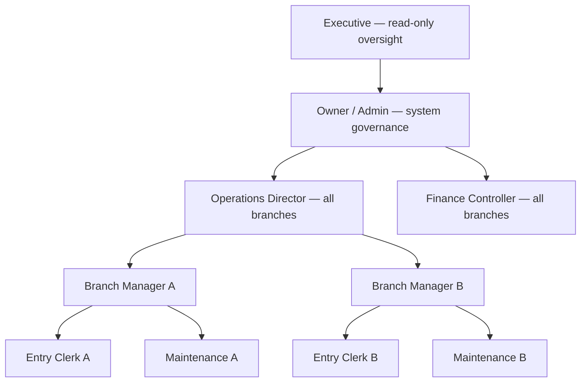

# Tester company workflow design

## Goal

Make each ROUTIQ test workspace behave like a small, understandable operating company. Every fixed application role must have a real job, each branch must have a local team, and the handbook must guide a tester through the handoffs between those people.

The result will be available both locally and on `demo.truesignaldigital.com`. Because the environment contains no real users or production data, the public handbook will show the disposable test usernames and six-digit PINs directly.

## Organization model

Each workspace has a four-person all-branch team and a three-person team in each of its two branches:

The reporting lines explain the company; application authorization remains role plus branch scope. The Operations Director and Branch Managers all use `OPS_MANAGER`. The director receives `ALL` branch scope, while each branch manager receives only their own branch.

## Public test accounts

Existing usernames and PINs remain stable. New accounts follow the same role-oriented naming scheme.

### Trucking Test

| Job | Username | PIN | Application role | Branch scope |
| --- | --- | --- | --- | --- |
| Owner / Admin | `admin@trucking.test` | `111111` | `ADMIN` | All branches |
| Operations Director | `ops@trucking.test` | `121212` | `OPS_MANAGER` | All branches |
| Douala Branch Manager | `manager.douala@trucking.test` | `131313` | `OPS_MANAGER` | Douala (`DLA`) |
| Bafoussam Branch Manager | `manager.bafoussam@trucking.test` | `141414` | `OPS_MANAGER` | Bafoussam (`BAF`) |
| Douala Entry Clerk | `entry@trucking.test` | `222222` | `FIELD_SUBMITTER` | Douala (`DLA`) |
| Bafoussam Entry Clerk | `entry.bafoussam@trucking.test` | `232323` | `FIELD_SUBMITTER` | Bafoussam (`BAF`) |
| Douala Maintenance | `maintenance.douala@trucking.test` | `242424` | `MAINTENANCE` | Douala (`DLA`) |
| Bafoussam Maintenance | `maintenance.bafoussam@trucking.test` | `252525` | `MAINTENANCE` | Bafoussam (`BAF`) |
| Finance Controller | `approver@trucking.test` | `333333` | `FINANCE_APPROVER` | All branches |
| Executive | `executive@trucking.test` | `343434` | `EXECUTIVE_VIEWER` | All branches |

### Passenger Test

| Job | Username | PIN | Application role | Branch scope |
| --- | --- | --- | --- | --- |
| Owner / Admin | `admin@passenger.test` | `444444` | `ADMIN` | All branches |
| Operations Director | `ops@passenger.test` | `454545` | `OPS_MANAGER` | All branches |
| Yaoundé Branch Manager | `manager.yaounde@passenger.test` | `464646` | `OPS_MANAGER` | Yaoundé (`YDE`) |
| Kribi Branch Manager | `manager.kribi@passenger.test` | `474747` | `OPS_MANAGER` | Kribi (`KRI`) |
| Yaoundé Entry Clerk | `entry@passenger.test` | `555555` | `FIELD_SUBMITTER` | Yaoundé (`YDE`) |
| Kribi Entry Clerk | `entry.kribi@passenger.test` | `565656` | `FIELD_SUBMITTER` | Kribi (`KRI`) |
| Yaoundé Maintenance | `maintenance.yaounde@passenger.test` | `575757` | `MAINTENANCE` | Yaoundé (`YDE`) |
| Kribi Maintenance | `maintenance.kribi@passenger.test` | `585858` | `MAINTENANCE` | Kribi (`KRI`) |
| Finance Controller | `approver@passenger.test` | `666666` | `FINANCE_APPROVER` | All branches |
| Executive | `executive@passenger.test` | `676767` | `EXECUTIVE_VIEWER` | All branches |

The public credentials page must call these disposable test accounts and warn that they must be removed or have their PINs replaced before real-user onboarding.

## Role responsibilities

- **Owner / Admin (`ADMIN`)** configures branches, members, categories, templates, and approval thresholds. Admin can perform most operational and finance actions, but cannot approve their own submission.
- **Operations Director (`OPS_MANAGER`, all branches)** supervises assets and activities across the company, handles cross-branch operations, and sees both local teams.
- **Branch Manager (`OPS_MANAGER`, one branch)** registers people and assets, commissions assets, supervises activities, and reopens closed activities in one branch.
- **Entry Clerk (`FIELD_SUBMITTER`, one branch)** records daily activities, legs, documents, revenue, costs, and meter readings in one branch. The role cannot register or commission assets and cannot approve money.
- **Maintenance (`MAINTENANCE`, one branch)** currently records meter readings and views operational history in one branch. The handbook must not claim that work orders or a complete maintenance workflow exist yet.
- **Finance Controller (`FINANCE_APPROVER`, all branches)** approves or rejects submitted financial entries, reverses posted entries, manages financial periods, and decides cross-branch transfers. Maker and approver must be different people.
- **Executive (`EXECUTIVE_VIEWER`, all branches)** reviews dashboards and operational records without any write affordance.

## End-to-end company flow

The guided scenario is a repeatable handoff between accounts:

1. The Admin verifies the two branches and company membership.
2. A Branch Manager registers and commissions an asset in the first branch.
3. The Entry Clerk creates an activity, records movement details, attaches operating costs and revenue, and closes it.
4. Maintenance records a meter reading for the asset.
5. The Branch Manager reviews the branch work and demonstrates manager-only correction or reopen behavior.
6. A large entry moves to the Finance Controller, who approves or rejects it; a small entry posts immediately.
7. The Operations Director initiates a cross-branch transfer and Finance completes the approval-dependent handoff.
8. The second branch team confirms that the transferred asset is now in its scope and continues operating it.
9. Finance demonstrates reversal and period locking.
10. The Executive reviews the resulting company-wide state without being able to change it.

Negative checks are part of the flow: a branch-scoped account cannot see the other branch, an Entry Clerk cannot register assets, Maintenance cannot perform general operating writes, an Executive cannot mutate data, and no maker can approve their own submission.

## Handbook structure

- `start-here/01-access.md` becomes the quick-login reference with both public account tables and the test-only warning.
- `start-here/02-accounts.md` becomes the role and responsibility reference for all six roles, including the distinction between Operations Director and Branch Manager.
- A new company-flow page explains the organization chart and the account-to-account handoffs.
- `walkthroughs/branches.md` becomes a branch hierarchy and isolation walkthrough rather than a placeholder.
- `testing/how-to-test.md` becomes an ordered, multi-account company scenario.
- Existing asset, activity, approval, and passenger walkthroughs identify the actor, the handoff, and the expected outcome where relevant.
- The VitePress navigation and handbook home page link the new flow.
- Screenshots are refreshed where the expanded Users table or new account flow is necessary for comprehension.

The quick-login reference is a reference document, the company flow is an explanation, and the guided scenario and existing walkthroughs remain tutorials/how-to material.

## Provisioning and verification

Accounts must be created through ROUTIQ's audited member commands, never by direct database inserts. Provisioning is additive and preserves the three existing accounts in each workspace.

Verification covers both local and live environments:

- all 20 credentials authenticate with their documented workspace slug and PIN;
- every returned membership has the expected role and branch scope;
- branch-scoped accounts cannot read the other branch;
- each role can reach its documented screens and is denied actions outside its job;
- the handbook builds with its configured `/team-docs-k4v9w2/` base path;
- public handbook pages, screenshots, local search, and Mermaid render in a real browser;
- the demo root and `files.truesignaldigital.com` continue to respond after deployment.

Work stays in the `docs/tester-handbook` worktree. No ports, processes, or files belonging to the user's other development session are stopped or overwritten.
